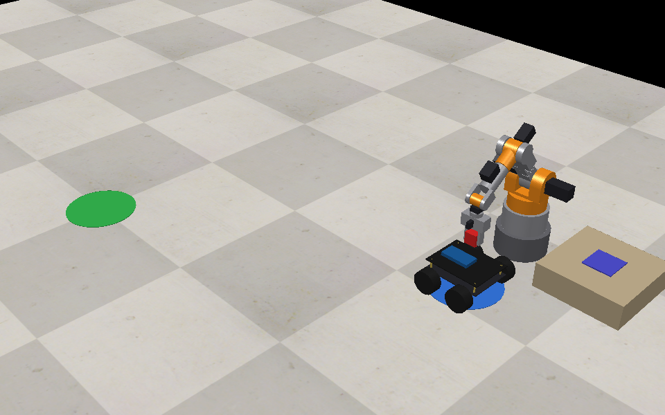

### 2.1 Operación

**Celda de abastecimiento de piezas.**
1. En la estación de carga **A**, el AGV recibe una pieza en su bandeja.
2. La lleva hasta la estación **B**, al lado de la mesa del brazo: 1,2 m de avance y una aproximación
   **lateral** de 0,6 m.
3. El brazo 6R toma la pieza de la bandeja del AGV y la coloca en el alojamiento de la bandeja de trabajo
   **C**, girada 90° alrededor de la vertical.
4. El AGV vuelve vacío a A.

La aplicación se eligió porque usa las dos capacidades que pide el enunciado:
- el desplazamiento lateral del mecanum (§5.4);
- un tramo cartesiano con orientación especificada del brazo: el descenso vertical para insertar la pieza.

Además, la pieza es la misma en los dos robots: misma masa, mismo centro de masa y mismas condiciones de
entrega.

### 2.2 Pieza y estaciones

Tabla: Datos de la pieza

| Dato | Valor | Origen |
|---|---|---|
| Forma | Cubo de 40 × 40 × 40 mm, PLA con lastre interior | definido |
| Masa | 0,100 kg | definido (se ajusta el lastre con balanza) |
| Centro de masa e inercia | Centro geométrico; m·a²/6 = 2,67·10⁻⁵ kg·m² | calculado (cubo homogéneo equivalente) |
| Agarre | Pinza paralela de 2 dedos sobre dos caras opuestas; apertura máxima 70 mm | definido |
| Alojamientos (AGV y bandeja C) | 46 × 46 mm con chaflán de entrada | definido |

**Marcos de referencia** (convenciones de la cátedra: SI, radianes, giros positivos antihorarios):

| Marco | Definición |
|---|---|
| {G} | Piso de la celda: origen en la marca de A, x hacia B, z hacia arriba |
| {AGV} | Centro geométrico del AGV: x hacia adelante, y a la izquierda |
| {0} | Base del brazo: origen en el eje 1, a la altura del plano de apoyo, z vertical |
| {TCP} | Punto de herramienta: entre los dedos, en el centro de la pieza tomada |

La base del brazo está en (1,2; 0,9) m de {G}, girada −90°, sobre un pedestal de 90 mm. Esa es la altura de
la bandeja del AGV. Así:
- la toma (0,30; 0; 0,02) m de {0} coincide con B, donde se detiene el AGV;
- la colocación (0; 0,30; 0,02) m de {0} cae en la bandeja C;
- las dos tienen aproximaciones 80 mm más arriba.

### 2.3 Requisitos

Tabla: Requisitos del brazo antropomórfico

| Id | Requisito | Valor | Justificación |
|---|---|---|---|
| R‑B‑1 | Alcance horizontal del TCP con la herramienta hacia abajo | ≥ 0,38 m | Toma a 0,30 m más margen a la singularidad de brazo estirado |
| R‑B‑2 | Configuración | 6R con muñeca esférica | Permite cinemática inversa analítica por desacople |
| R‑B‑3 | Carga nominal / máxima | 0,10 / 0,25 kg | Pieza más margen; la máxima se justifica con el par del eje más exigido |
| R‑B‑4 | Error de posición en la colocación | ≤ 1 mm | Holgura del alojamiento: (46 − 44)/2 mm por lado, con la pieza en la pinza |
| R‑B‑5 | Error de orientación en la colocación | ≤ 1° | 1° desplaza la esquina del cubo ≈ 0,5 mm |
| R‑B‑6 | Error de seguimiento | ≤ 5 mm | No tocar el borde del alojamiento en la aproximación |
| R‑B‑7 | Ciclo toma–colocación–retorno | ≤ 12 s | Compatible con el ciclo del AGV |
| R‑B‑8 | Velocidad y aceleración articulares | 90–180 °/s, 180–360 °/s² según el eje | Accionamientos paso a paso con reducción |
| R‑B‑9 | Fabricación | PLA, cama ≤ 220 × 220 mm | Impresora típica disponible |

Tabla: Requisitos del AGV

| Id | Requisito | Valor | Justificación |
|---|---|---|---|
| R‑AGV‑1 | Recorrido A→B | 1,2 m en x + 0,6 m lateral | Muestra avance y capacidad lateral |
| R‑AGV‑2 | Velocidad / aceleración del cuerpo | 0,25 m/s, 0,30 m/s² | Debajo del límite de rueda; la pieza no desliza (a ≪ μg) |
| R‑AGV‑3 | Error de llegada a B, con referencia externa | ≤ 20 mm y ≤ 3° | Capacidad de captura de la pinza: apertura 70 mm para una pieza de 40 mm |
| R‑AGV‑4 | Tiempo de traslado A→B | ≤ 15 s | Ciclo total ≤ 45 s |
| R‑AGV‑5 | Período de control de ruedas | 10 ms | Resolución de los encoders a baja velocidad y estabilidad del PI |
| R‑AGV‑6 | Seguridad | Parada desde la interfaz, parada ante pérdida de comunicación (300 ms), límites de PWM y velocidad, reinicio controlado | Enunciado §5.5 |

**Ciclo completo:** carga en A → traslado A→B (≤ 15 s) → toma y colocación (≤ 12 s) → retorno (≤ 15 s), en
total ≤ 45 s.

**Cambios de requisitos.** Durante el desarrollo se ajustaron tres valores, y cada cambio quedó registrado
con su motivo en `00_Aplicacion_y_plan.md` §7:
- la v_máx del AGV, de 0,20 a 0,25 m/s, para cumplir R‑AGV‑4;
- el período de control de ruedas, de 20 a 10 ms;
- la velocidad cartesiana del brazo, de 0,10 a 0,15 m/s, para cumplir R‑B‑7.
