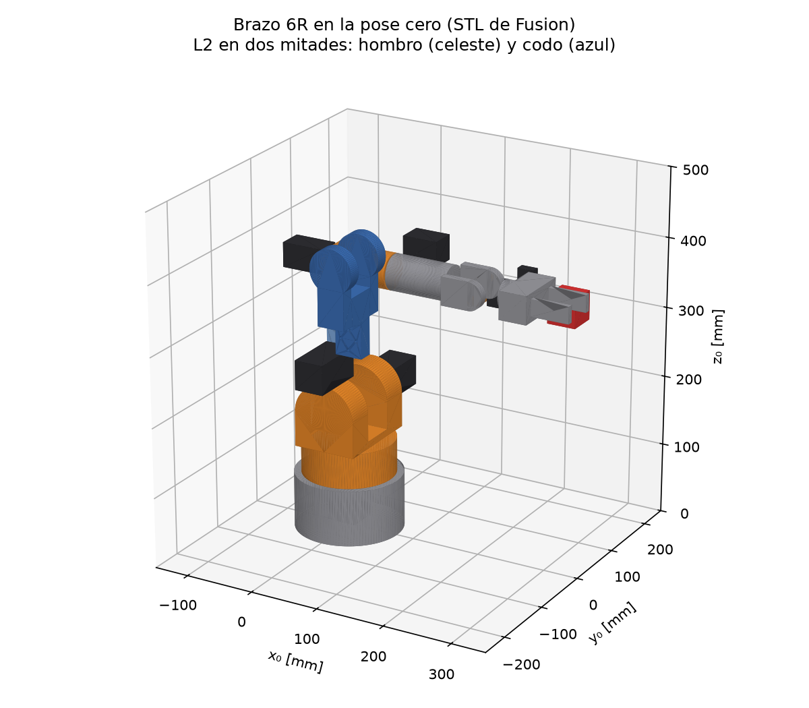

## 4.A Brazo antropomórfico imprimible

> CAD: script paramétrico `brazo/cad/fusion_brazo/fusion_brazo.py`, que lee `parametros/parametros.json`.
> Documento de Fusion vigente: «robot». Archivos exportados: `brazo/stl/*.stl` y `*.3mf` (en mm, en la pose
> cero y en el marco {0}). Propiedades de masa: `brazo/cad/propiedades_fusion.csv`. Uso: `brazo/cad/LEEME_CAD.md`.

### 4.A.1 Criterio de diseño y geometría

- **Cómo se genera el CAD.**
  1. El script calcula con la cinemática directa los puntos clave de la pose cero: base O, hombro S, codo E,
     muñeca W, brida F y TCP T.
  2. Arma cada eslabón como unión de cilindros y prismas ubicados respecto de esos puntos.
  3. Crea las seis articulaciones de revolución sobre los ejes DH.
  4. Exporta los STL y las propiedades físicas.
- **Por qué así.** Las cotas que importan para el modelo (d₁, a₂, d₄, d₆ y la herramienta) son **las mismas**
  en el CAD, en Octave y en CoppeliaSim. Un cambio de medida en la tabla única se propaga a todo el proyecto
  volviendo a ejecutar el script.
- **Comprobación.** `verificar_pose_cero.m` compara los puntos clave del CAD con la cinemática directa. Los
  volúmenes y centros de masa de Octave coinciden con los de Fusion dentro de 0,1 % y 0,01 mm.
- **Alcance.** La geometría es **simplificada**. Representa bien las masas, las inercias y el volumen
  ocupado, pero no detalla alojamientos de rodamientos ni reductores. Esos detalles se indican como
  propuesta en 4.A.3 y 4.C.

Tabla: Eslabones del brazo (estructura impresa con densidad efectiva de 800 kg/m³; los motores, con la masa del catálogo)

| Eslabón | Forma principal | Estructura [kg] | Motor que lleva | Total [kg] |
|---|---|---|---|---|
| L0 base | Cilindro Ø150 × 80 mm | 1,130 | M1 (eje 1) | fija |
| L1 hombro | Torreta Ø130 + horquilla de dos orejas 90 × 40 × 50 mm | 1,058 | M2 (eje 2) | 1,538 |
| L2 brazo | Viga 40 × 44 mm, cubo Ø70 en el hombro, horquilla en el codo; **dos mitades** | 0,487 | M3 (eje 3) | 0,967 |
| L3 codo | Cubo Ø60 + tubo Ø50 | 0,169 | M4 (eje 4) | 0,369 |
| L4 antebrazo | Tubo Ø50 + horquilla de muñeca, orejas de 12 mm | 0,181 | M5 (eje 5) | 0,361 |
| L5 muñeca | Cubo Ø36 | 0,029 | M6 (eje 6) | 0,089 |
| L6 brida y pinza | Brida Ø40, cuerpo 40 × 80 × 40 mm, dos dedos 55 × 8 × 24 mm | 0,132 | Servo de la pinza | 0,147 |

### 4.A.2 Herramienta

- **Tipo.** Pinza paralela de dos dedos, accionada por un micro servo de 15 g. Los dedos cierran según y₀ en
  la toma.
- **Medidas.** Apertura máxima de 70 mm para la pieza de 40 mm. El TCP está a 80 mm de la brida sobre z₆, en
  el centro de la pieza tomada.
- **Margen de captura.** La holgura de apertura, (70 − 40)/2 = 15 mm por lado, es la que fija el error de
  llegada admisible del AGV (R‑AGV‑3: ≤ 20 mm, junto con el chaflán del alojamiento).
- **Fuerza de agarre.** Para sostener 0,25 kg con μ = 0,3 y una aceleración de 5 m/s² hacen falta
  F = m(g + a)/(2μ) ≈ 6 N por dedo. Un micro servo de 0,18 N·m con un brazo de 20 mm entrega ≈ 9 N.

### 4.A.3 Accionamientos y transmisiones

El dimensionamiento está en la sección 5.B.4 y la verificación a lo largo del ciclo en la 6.A.3.

Tabla: Accionamientos del brazo

| Eje | Motor (par máx.) | Reducción N | η | Ubicación y transmisión | Uso pico en el ciclo |
|---|---|---|---|---|---|
| 1 | NEMA 17 de 48 mm (0,45 N·m) | 20 | 0,80 | En la base, coaxial; reductor planetario impreso de dos etapas | 4 % |
| 2 | NEMA 17 de 48 mm (0,45 N·m) | **30** | 0,80 | En el hombro (L1), coaxial; reductor cicloidal impreso | 31 % |
| 3 | NEMA 17 de 48 mm (0,45 N·m) | 15 | 0,80 | Sobre L2 cerca del hombro; correa GT2 hasta el codo más reductor (el motor cerca del hombro baja la inercia distal) | 18 % |
| 4 | NEMA 14 de 28 mm (0,12 N·m) | 10 | 0,85 | Detrás del codo (contrapeso), coaxial con el antebrazo | 1 % |
| 5 | NEMA 14 de 28 mm (0,12 N·m) | 10 | 0,85 | Sobre el antebrazo; correa hasta el eje de la muñeca | 3 % |
| 6 | Micro paso a paso (0,05 N·m) | 5 | 0,85 | Dentro de la muñeca, coaxial con la brida | 0 % |

- **Hipótesis de actuador.** Las leyes de control dinámico de la sección 7.A mandan par. Con motores paso a
  paso, eso requiere **drivers de lazo cerrado con encoder magnético y control de corriente**, por ejemplo
  de la familia MKS SERVO42 para NEMA 17. Con drivers de paso abiertos, el brazo se controlaría en posición y
  las leyes de la sección 7 describirían el lazo interno del driver.
- **Reductores impresos.** Tienen juego y rozamiento apreciables. El rozamiento está en el modelo como
  fricción viscosa y de Coulomb del lado articular (valores estimados en `parametros.json`) y el controlador
  conoce solo el 70 % de él. El juego no está modelado: queda como limitación declarada.
- **Inercia reflejada.** N²J_m vale, por ejemplo, 0,0049 kg·m² en el eje 2, del mismo orden que la inercia
  del brazo. Está incluida en M(q).
