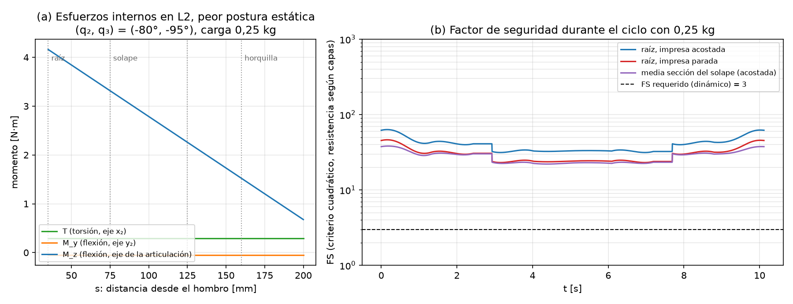

## 4.B Verificación estructural de una pieza impresa crítica: eslabón L2

Enunciado §4.2: *verificar resistencia y deformación de al menos un elemento estructural crítico en una
condición de carga justificada, con propiedades del material impreso que contemplen la dirección de las
capas; método analítico o simulación, con hipótesis y datos identificados.*

Método: **analítico** (viga de pared delgada), con las cargas internas **exactas** que da Newton–Euler
sobre el ciclo real del brazo. Script: `brazo/octave/verificacion_estructural.m`; resultados:
`brazo/resultados/verificacion_estructural.txt`; figura: `brazo/resultados/figuras/estructural_L2.png`.

## 4.B.1 Elección del elemento crítico

El momento más grande que puede llegar a una pieza es el par de bloqueo del accionamiento que la carga
(motor saturado contra un obstáculo): τ_bloqueo = N · τ_m,máx, sin descontar el rendimiento (si el
reductor es retroimpulsado, η no protege). Comparación rápida, solo paredes impresas:

| Pieza / sección | Momento de bloqueo | Módulo resistente | Tensión nominal |
|---|---|---|---|
| L0 base, cilindro Ø150 (torsión del eje 1, corte entre capas) | 20 · 0,45 = 9,0 N·m | 2πr²t = 63 600 mm³ | 0,14 MPa (corte) |
| L2 brazo, raíz (40 × 44 mm) | 30 · 0,45 = **13,5 N·m** | 3 374 mm³ | 4,0 MPa |
| **L2 brazo, media sección del solape (40 × 22 mm)** | **13,5 N·m** | **1 928 mm³** | **7,0 MPa** |
| L3 codo, tubo Ø50 | 15 · 0,45 = 6,75 N·m | πr²t = 3 534 mm³ | 1,9 MPa |
| L4 orejas de la muñeca (2 × 40 × 12 mm) | 10 · 0,12 = 1,2 N·m | 6 400 mm³ | 0,19 MPa |

**L2 es el elemento crítico**: es el que tiene el momento más grande, porque soporta todo lo que viene
después con el brazo de palanca más largo. Además tiene un problema de fabricación que lo vuelve todavía
más exigido:

> **L2 no entra en la cama de la impresora.** Su envolvente es 70 × 90 × 267 mm. En una cama de
> 220 × 220 mm (R‑B‑9) no entra acostado (267 > 220), ni en diagonal ((267 + 70)/√2 = 238 > 220).
> Parado necesita 267 mm de altura y la mayoría de las impresoras tiene 250 o menos. **Decisión:**
> imprimirlo en dos mitades (L2a y L2b, de 150 y 167 mm) unidas con un solape a media altura,
> 2 tornillos M4 y 2 pasadores Ø4.
> Esa unión pasa a ser la sección más débil (fila resaltada) y es la que se verifica en detalle.

## 4.B.2 Geometría, impresión y dirección de capas

Marco {2} de DH: x₂ a lo largo del eslabón (de S a E), z₂ = eje de las articulaciones 2 y 3, y₂ = z₂ × x₂.
Coordenada s = distancia desde el hombro.

| Tramo | s [mm] | Sección (y₂ × z₂) |
|---|---|---|
| Cubo del hombro | −35 … 35 | cilindro Ø70 × 44 |
| Viga | 35 … 120 | 40 × 44 |
| Solape de la unión | 65 … 115 | dos mitades de 40 × 22; 2 × M4 en s = 75 y 105; 2 pasadores Ø4 en s = 90, y₂ = ±12 |
| Base de la horquilla | 120 … 160 | 40 × 90 |
| Orejas del codo | 160 … 200 | 2 × (40 × 20) a z₂ = ±35 mm |

**Parámetros de impresión** (`parametros.json` → `brazo.material.impresion`): PLA, boquilla 0,4 mm,
capas de 0,2 mm, 4 perímetros (1,8 mm), 6 capas sólidas arriba/abajo (1,2 mm), relleno giroide 30 %.
Para resistencia se cuentan **solo las paredes**: perímetros y capas sólidas. El relleno solo se usa como
cota superior de rigidez.

**Orientación — dos alternativas:**

| | Acostado (elegido) | Parado |
|---|---|---|
| Dirección de construcción | z₂ (eje de la articulación) | x₂ (eje del eslabón) |
| Tensión normal de flexión σₓ | **en el plano de la capa, a lo largo de los perímetros** | perpendicular a las capas (la adhesión entre capas trabaja a tracción) |
| Resistencia que se compara | 44,4 MPa | 28,4 MPa |
| Agujeros de ejes y tornillos (eje z₂) | verticales: redondos, sin soportes | horizontales: hace falta forma de lágrima o soportes |
| Cabe en 220 × 220 × 250 | sí (mitades de 70 × 150 × 44 y 64 × 167 × 90 mm) | no (267 mm) |

**Material** (`parametros.json` → `brazo.material.resistencia`). Valores de diseño = 80 % de los medidos
por Eryildiz (2021) en probetas de PLA por FDM: 55,5 MPa impresas planas y 35,5 MPa paradas, o sea 36 %
menos cuando la carga es perpendicular a las capas. Chacón et al. (2017) encontraron la misma tendencia: la
orientación parada es la más débil. El 20 % de descuento cubre la dispersión entre filamentos e
impresoras.

| Propiedad | Valor | Uso |
|---|---|---|
| σ en el plano de la capa (s_xy) | 44,4 MPa | σₓ con la pieza acostada |
| σ perpendicular a las capas (s_z) | 28,4 MPa | σₓ con la pieza parada |
| τ en el plano (s_xy/√3) | 25,6 MPa | corte en las capas sólidas |
| τ entre capas (s_z/√3) | 16,4 MPa | corte en los perímetros (actúa sobre las interfaces) |
| E en el plano | 3,0 GPa (rango 2,5–3,5) | deformación |
| E del relleno 30 % (relativo) | 0,10 (estimado) | cota superior de rigidez |

## 4.B.3 Casos de carga

Las cargas internas salen de `rne_brazo`, que ahora devuelve la fuerza y el momento en cada articulación.
Para la sección a distancia s se aísla la parte superior de L2 (de s hasta E) junto con todo lo que viene
después, y se calcula de dos maneras:
- desde la raíz: F = f₂, M = n₂ + (S − p) × f₂;
- desde el codo: con f₃, n₃ y el peso del tramo de L2.

Se usa la más desfavorable. Se suma la compresión de la correa del eje 3: N = 2|τ₃|/r_polea, con un
radio de polea supuesto de r_polea = 30 mm.

| Caso | Condición | Justificación | FS requerido |
|---|---|---|---|
| C1 dinámico | Ciclo completo (10,1 s, 2024 muestras con q, q̇, q̈) con la **carga máxima 0,25 kg** en todo el tramo con pieza | Operación normal en el peor caso de carga (R‑B‑3) | 3 |
| C2 sostenido | Peor postura estática de una grilla (q₂, q₃) cada 5° con 0,25 kg: (q₂, q₃) = (−80°, −95°), brazo casi horizontal | El PLA tiene **fluencia lenta**: bajo carga permanente la tensión debe quedar ≤ 25 % de la resistencia | 4 |
| C3 accidental | **Colisión en el TCP con el motor 2 saturado**: fuerza perpendicular a (TCP − S) tal que el par en el eje 2 sea 13,5 N·m (F = 25,5 N). Tres posturas, ambos sentidos, con y sin carga | Es la carga más grande que el propio robot puede transmitirle a L2 | 2 |

**Tensiones** en la esquina más cargada: σ = |N|/A + |M_y|/W_y + |M_z|/W_z. Corte por torsión con la
fórmula de Bredt, τ = T/(2·A_m·t), más 1,5·V/A_alma en cada tipo de pared. Factor de seguridad con un
criterio cuadrático (Tsai–Hill), usando la resistencia de la dirección en que trabaja cada componente:
FS = 1/√((σ/s_σ)² + (τ/s_τ)²).

## 4.B.4 Resultados de resistencia



| Caso | Raíz, acostado | Raíz, parado | Solape (media sección, acostado) | Requerido |
|---|---|---|---|---|
| C1 ciclo con 0,25 kg | 31,4 | 23,1 | 21,3 | 3 |
| C2 peor postura sostenida | 23,7 | 17,2 | 16,2 | 4 |
| C3 colisión, motor 2 saturado | 8,5 | 6,0 | **5,4** | 2 |

- En el ciclo, el peor instante es t = 6,97 s (bajada a la colocación): M_z = 3,05 N·m, σ = 1,3 MPa.
- **Imprimirlo parado le quita un 26–29 % al FS**: la flexión carga la adhesión entre capas. Con 0,25 kg
  todavía cumple, pero no entra en la impresora y deja los agujeros horizontales. Queda descartado.
- **Concentración de tensiones** (no la modela una viga): en el encuentro de la viga con el cubo del
  hombro y en el extremo del solape se indican redondeos de R ≥ 5 mm. Aun con K_t = 2, el caso
  accidental sigue con FS ≥ 2,7.
- Conclusión: con las paredes indicadas **la resistencia sobra**. Lo que gobierna el diseño son la
  rigidez y la unión.

## 4.B.5 Unión de las dos mitades

Solape a media altura en z₂ (cada mitad conserva 22 mm), de s = 65 a 115 mm. Termina antes de la base de
la horquilla (s = 120 mm), para que la mitad del hombro no se lleve un pedazo de 90 mm de ancho. Lleva
2 tornillos M4 × 50 clase 8.8 pasantes en z₂, en s = 75 y 105 mm (p = 30 mm, 10 mm al borde), con tuerca
y arandela ancha DIN 9021. Los agujeros quedan verticales en la impresión. Área de contacto: 19,5 cm².
En el solape se usa un modificador de relleno 100 % y 6 perímetros alrededor de cada agujero.

Fuerzas por tornillo:
- en el plano del solape: la cupla M_z/p más N y V_y;
- fuera del plano (tracción por palanca): M_y/p, T/b y V_z.

| Caso | Corte por tornillo | FS tornillo (EN 1993‑1‑8) | Aplastamiento del PLA | FS | Desgarro hacia el borde (e = 10 mm) | FS |
|---|---|---|---|---|---|---|
| C1 ciclo | 83 N | 41 | 0,9 MPa | 47 | 0,19 MPa | 136 |
| C2 sostenida | 116 N | 29 | 1,3 MPa | 34 | 0,26 MPa | 97 |
| C3 colisión | 503 N | 6,7 | 5,7 MPa | 7,8 | 1,1 MPa | 22 |

**El problema no es la resistencia sino el deslizamiento.** Con una precarga de ≈ 1 kN por tornillo
(≈ 0,8 N·m de apriete; más ajuste aplasta el PLA) y μ = 0,3, la fricción toma 300 N por tornillo:
- En el ciclo (83 N) no desliza.
- En una colisión (503 N) sí.
- El PLA pierde precarga con el tiempo por fluencia lenta.

Si las mitades se apoyan sobre el juego de un agujero impreso (0,2 mm), el tramo superior gira
0,2/30 = 6,7 mrad. Eso son **hasta 2,2 mm en el TCP**, más del doble de R‑B‑4 (1 mm).

**Decisión:** agregar **2 pasadores de acero Ø4 h8 × 40** en s = 90 mm, y₂ = ±12 mm, en agujeros impresos
a Ø3,8 y escariados a Ø4 H7. Los pasadores ubican las mitades sin juego; los tornillos solo aprietan. El
corte de colisión (≈ 500 N por elemento) es chico para un pasador de acero Ø4 (sección 12,6 mm²: aguanta
varios kN).

## 4.B.6 Deformación

Se integran la curvatura de flexión M/(E·I), en y₂ y en z₂, y el giro por torsión T/(G·J) a lo largo de
L2, por tramos (viga, base de la horquilla, orejas), y se los traslada al TCP. El solape se toma como
continuo, porque los pasadores lo hacen trabajar así.

| Postura | Desplazamiento del TCP por L2 (solo paredes) | Con relleno (cota) |
|---|---|---|
| Toma, sin pieza | 0,26 mm | 0,22 mm |
| **Colocación con la pieza de 0,10 kg** | **0,30 mm** | 0,25 mm |
| Colocación con 0,25 kg | 0,37 mm | 0,30 mm |
| Peor postura C2 con 0,25 kg | 0,78 mm | 0,62 mm |

- Los encoders de los motores **no ven** esta deformación. En la colocación se suma al error del
  control: 0,46 mm con el par calculado + integral (§7.A). Total ≈ 0,76 mm < 1 mm (R‑B‑4), pero el margen
  es chico y faltan las demás contribuciones: L1, L3, L4, rigidez y juego de los reductores impresos.
- La deformación por gravedad **se repite** en una postura y con una carga dadas. Por eso conviene
  **enseñar el punto de colocación** (medirlo con el robot armado y corregirlo) en vez de confiar en la
  cinemática nominal. Esto se recomienda en el informe si se construye.
- Se mantienen las paredes indicadas aunque la resistencia sobre: con menos perímetros bajaría la masa,
  pero la deformación crecería casi en proporción a la pared que se saca, porque la rigidez sale casi
  toda de las paredes. La rigidez, no la resistencia, es el criterio que manda.

## 4.B.7 Hipótesis y limitaciones

1. Viga de Euler–Bernoulli de pared delgada, con secciones planas. Corte por torsión con Bredt y corte
   por fuerza transversal con un promedio sobre el alma × 1,5.
2. Material homogéneo por pared, con resistencia según la dirección de las capas. Los valores vienen de
   la bibliografía con 20 % de descuento: **conviene confirmarlos con 3 probetas planas y 3 paradas**
   del mismo filamento.
3. Se desprecian la masa del cubo del hombro (≈ 0,1 kg junto a S) y, en el cálculo desde el codo, el motor
   M3. Las dos estimaciones se envuelven.
4. La compresión de la correa del eje 3 se estima con una polea de 30 mm de radio, porque la transmisión
   todavía no está detallada.
5. No se modelan las concentraciones de tensión (de ahí los redondeos indicados), la fatiga ni la
   temperatura (el PLA se ablanda por encima de ≈ 55 °C: no dejar el brazo al sol ni junto a fuentes de
   calor).
6. Una simulación por elementos finitos (Fusion → Simulation → Static Stress, material ortótropo) sería
   un buen contraste del K_t en el encuentro cubo–viga. No hace falta para concluir, porque los FS
   tienen margen de sobra.

## 4.B.8 Plan de impresión preliminar

Medidas de los STL actuales (mm). Criterio de orientación: que la tensión principal quede en el plano de
la capa y que los agujeros de ejes queden verticales.

| Pieza | Envolvente | Orientación (dirección de construcción) | Notas |
|---|---|---|---|
| L0 base | 150 × 150 × 80 | z₀ (apoyada en la base) | La torsión del eje 1 hace corte entre capas: 0,14 MPa, sin problema |
| L1 hombro | 130 × 130 × 145 | z₀ | Agujeros del eje 2 horizontales → forma de lágrima |
| **L2a brazo, hombro** (`L2_brazo_a.3mf`) | 70 × 150 × 44 | **z₂ (acostado)**, apoyada en su cara z₂ = −22 mm | Sin soportes. Solape 100 % de relleno; R ≥ 5 mm en la raíz |
| **L2b brazo, codo** (`L2_brazo_b.3mf`) | 64 × 167 × 90 | **z₂ (acostado), dada vuelta**: apoyada en la oreja z₂ = +45 mm, con la cara de contacto del solape hacia arriba (sale lisa) | Soporte (≈ 58 cm²) bajo el solape y entre las orejas de la horquilla |
| L3 codo | 100 × 50 × 60 | eje 3 vertical | — |
| L4 antebrazo | 148 × 64 × 50 | eje 5 vertical | Cilindro horizontal: soportes o base plana de 45° |
| L5 muñeca | 36 × 36 × 36 | eje 5 vertical | — |
| L6 brida y pinza | 108 × 80 × 40 | z₀ (dedos acostados) | La flexión de los dedos queda en el plano de la capa |

Parámetros comunes: PLA, 210 °C / cama 60 °C, capa 0,2 mm, 4 perímetros, 6 capas sólidas, giroide 30 %,
brim en las piezas altas. Agujeros de paso M4 impresos a Ø4,4. Agujeros de pasadores impresos a Ø3,8 y
escariados.

**División en el CAD.** La define `parametros.json` (eslabón `L2_brazo`, bloque `division`). La aplica el
script de Fusion, que hace los agujeros y crea los cuerpos `estructura_a` y `estructura_b`.
`brazo/python/division_L2.py` aplica la misma operación sobre la malla y comprueba:
- que las mitades sean estancas y no se superpongan (volumen a + b = volumen de la unión = 608,9 cm³);
- que cada una entre en la cama;
- cuánta superficie necesita soporte.

Por los agujeros, la masa de la estructura de L2 baja 0,4 % (0,489 → 0,487 kg). Es despreciable para la
dinámica y el control, así que no se volvieron a correr.

## Reproducción

```bash
octave-cli --eval "cd brazo/octave; verificacion_estructural"
```
```bash
py -3.13 brazo/python/figuras_estructural.py
```
```bash
py -3.13 brazo/python/division_L2.py
```

## Referencias

- Eryildiz, M. (2021). *Effect of build orientation on mechanical behaviour and build time of FDM
  3D‑printed PLA parts: an experimental investigation.* European Mechanical Science 5(3):116–120.
  doi:10.26701/ems.881254
- Chacón, J. M. et al. (2017). *Additive manufacturing of PLA structures using fused deposition modelling:
  effect of process parameters on mechanical properties and their optimal selection.* Materials & Design
  124:143–157. doi:10.1016/j.matdes.2017.03.065
- EN 1993‑1‑8 (Eurocódigo 3): resistencia de tornillos a corte y tracción.
