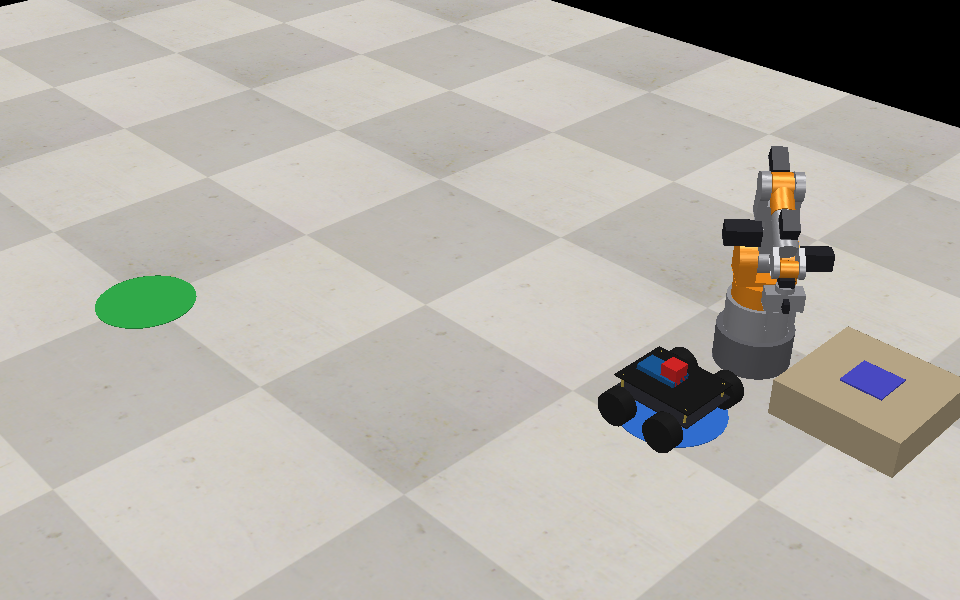

## 4.D Relevamiento del kit OSOYOO y representación del AGV

### 4.D.1 Datos del kit

Versión identificada: **OSOYOO «M2.0 Metal Mecanum» para Arduino Mega 2560**. Cada dato se clasifica en:
- **D** documentado: manual u hoja de datos;
- **M** medido;
- **C** calculado;
- **E** estimado.

Los valores E se reemplazan por los medidos en el laboratorio (sección 8.B), y todos están en
`parametros.json`, en el bloque `agv`.

Tabla: Parámetros del AGV y su procedencia

| Dato | Valor | Clase | Fuente / método |
|---|---|---|---|
| Ancho total exterior | 245 mm | D | Manual M2.0, p. 1 |
| Placa del chasis | 200 × 155 mm | D | Manual M2.0, p. 1 |
| Rueda mecanum | Ø80 × 36 mm, rodillos a 45° | D | Manual M2.0, p. 1 |
| Semitrocha l_y | 107,6 mm | E / a medir | Proyecto de referencia del mismo kit. Con el manual, (245 − 36)/2 = 104,5 mm. Se mide centro a centro |
| Semidistancia entre ejes l_x | 62,2 mm | E / a medir | Proyecto de referencia; se mide en el laboratorio |
| Radio efectivo r | 40 mm | E / a calibrar | Se calibra con N vueltas medidas por encoder |
| Patrón de rodillos | X (supuesto) | a verificar | Si resulta O, el firmware invierte el eje lateral (`GEO … −1`) |
| Motorreductor | GM25‑370, 75:1, 9 V, encoder Hall de 11 PPR | D | Hoja de datos del motor |
| Cuentas por vuelta de rueda | 11 × 75 × 4 = 3300 (×4) | C / a medir | 10 vueltas a mano con `HALL` |
| Driver | «Model Y» v2.0, 2 × TB6612 | D | Manual V2, p. 4 |
| Alimentación | 2 × 18650 en serie, 7,4 V nominal | D | Lista de partes |
| Masa | 1,5 kg | E / a medir | Balanza |
| Inercia I_z | 0,017 kg·m² | C | Placa de 0,9 kg más 4 conjuntos rueda‑motor de 0,15 kg en (±l_x, ±l_y) |

**Conexionado.**
- **Encoders.** No vienen conectados de fábrica. Se propone llevar los 8 canales Hall a A8–A15 (puerto K de
  la Mega), que comparten una sola interrupción por cambio de pin (PCINT2). Así se decodifican en
  cuadratura ×4 sin ocupar las interrupciones externas.
- **Motores.** Mantienen el cableado del manual (p. 10).

Tabla: Conexionado del AGV a la Arduino Mega

| Rueda | PWM | IN1 / IN2 | Encoder A / B |
|---|---|---|---|
| FL delantera izquierda | D10 | D26 / D28 | A9 / A13 |
| FR delantera derecha | D9 | D22 / D24 | A8 / A12 |
| RL trasera izquierda | D12 | D7 / D8 | A11 / A15 |
| RR trasera derecha | D11 | D5 / D6 | A10 / A14 |

### 4.D.2 Representación del AGV

- **Representación geométrica.** Se usa la del entorno gráfico (`coppelia/construir_escena.py`). Está
  construida con las medidas de `parametros.json`:
  - placas de 200 × 155 mm a 55 y 90 mm de altura, con la superior como bandeja;
  - ruedas de Ø80 × 36 mm en (±l_x, ±l_y);
  - motores, columnas y la placa Mega en sus ubicaciones relativas.
- **Coherencia.** El marco {AGV} de esa representación, con origen en el centro geométrico, es el mismo del
  modelo cinemático (5.C) y del firmware.
- **Al medir.** Cuando se midan l_x, l_y y la altura de la bandeja, se actualiza el JSON y se regenera la
  escena.
- **Pendiente:** un CAD editable del AGV en Fusion con las medidas relevadas. La representación actual
  alcanza para el entorno gráfico y para la ubicación de componentes, pero no es un CAD de piezas.

