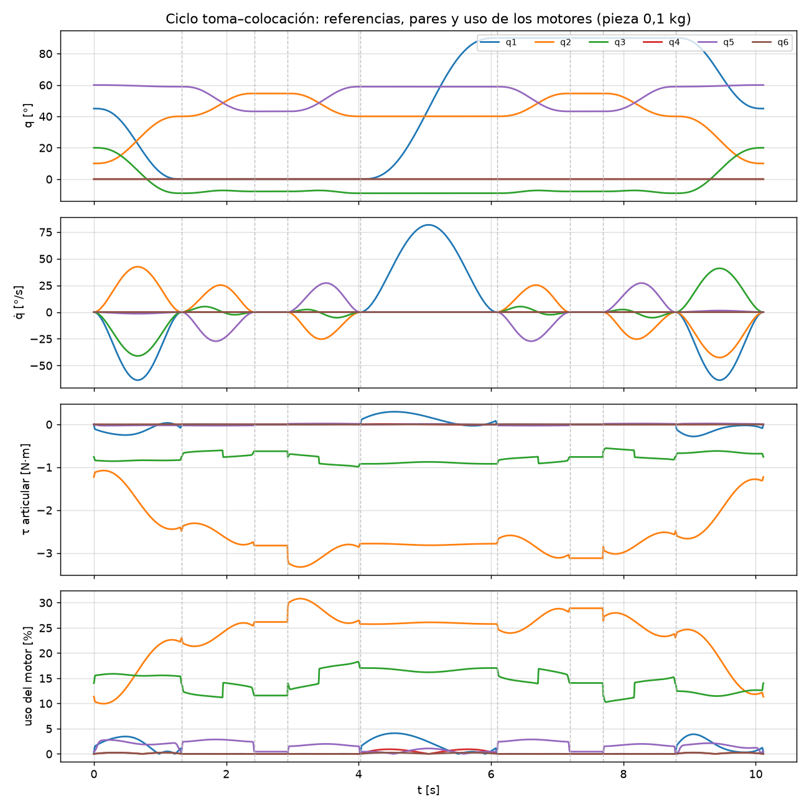
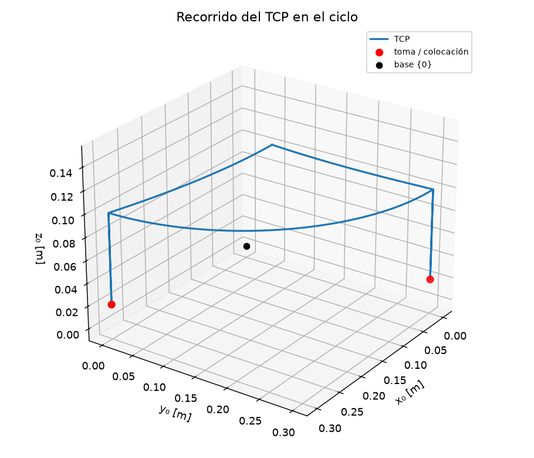

# 6.A Trayectorias del brazo (borrador para el informe)

> Código: `brazo/octave/` (`quintico.m`, `tramo_ptp.m`, `tramo_lin.m`, `generar_ciclo_brazo.m`,
> `verificar_trayectoria_brazo.m`). Figuras: `brazo/python/figuras_ciclo.py`.
> Resultados: `brazo/resultados/verificacion_trayectoria.txt`, `ciclo_brazo.csv`, `figuras/`.
> Referencias: apunte de cátedra Tema IV; Barrientos et al. (2007) §§6.2–6.5.

## 6.A.1 Construcción de las referencias

El ciclo de la tarea encadena nueve tramos:

Tabla: Tramos del ciclo del brazo

| # | Tramo | Tipo | Carga | T [s] |
|---|---|---|---|---|
| 1 | HOME → aproximación de la toma | PTP articular | — | 1,32 |
| 2 | Bajada de 80 mm a la toma | LIN, herramienta vertical | — | 1,10 |
| 3 | Cierre de la pinza | Espera | — | 0,50 |
| 4 | Subida con la pieza | LIN | 0,1 kg | 1,10 |
| 5 | Traslado a la aproximación de la colocación (pieza girada 90°) | PTP | 0,1 kg | 2,06 |
| 6 | Bajada a la colocación | LIN | 0,1 kg | 1,10 |
| 7 | Apertura de la pinza | Espera | 0,1 kg | 0,50 |
| 8 | Subida sin la pieza | LIN | — | 1,10 |
| 9 | Regreso a HOME | PTP | — | 1,32 |
|   | **Ciclo completo** | | | **10,11** (R‑B‑7: ≤ 12 s ✓) |

- **Ley temporal.** Todos los tramos usan el quíntico de reposo a reposo s(u) = 10u³ − 15u⁴ + 6u⁵. Posición,
  velocidad y aceleración son continuas en los empalmes con las esperas.
- **Tramos PTP.** Interpolan las seis juntas con una duración común, fijada por la junta más restrictiva:
  T ≥ máxᵢ(15|Δqᵢ|/(8Vᵢ), √(10√3|Δqᵢ|/(3Aᵢ))). Se multiplica por un margen de 1,10, se redondea hacia arriba
  a un múltiplo del período de muestreo y se usa la diferencia **con signo** Δq = q_B − q_A.
- **Tramos LIN.**
  - El TCP sigue una recta p(s) = p_A + (p_B − p_A)s.
  - La orientación se interpola por eje–ángulo, R(s) = R_A·Rot(n, sθ) con la fórmula de Rodrigues. Esto
    conserva una rotación válida, a diferencia de promediar matrices. En el ciclo, θ = 0: la herramienta se
    mantiene vertical durante la bajada y la subida (orientación especificada).
  - La duración mínima sale de v_cart,máx = 0,15 m/s y a_cart,máx = 0,5 m/s², con el mismo margen.
  - Las juntas se obtienen por MCI analítica, tomando como referencia la muestra anterior para no cambiar de
    rama. Las velocidades se calculan con q̇ = J⁻¹[ṗ; ω] y las aceleraciones con q̈ = J⁻¹([p̈; α] − J̇q̇),
    donde J̇ se obtiene por diferencia central en la dirección de q̇.
  - Si alguna junta excediera sus límites, el tramo se alarga un 5 % y se recalcula. En este ciclo no hizo falta.
- **Giro de 90° de la colocación.** Lo resuelve el eje 1 durante el traslado: como la pieza se deja girada 90°
  respecto del marco de la celda, la muñeca no necesita girar (q₄ = q₆ = 0 en todo el ciclo).
- **Registro de cambio.** Con v_cart,máx = 0,10 m/s el ciclo duraba 12,31 s y no cumplía R‑B‑7. Se pasó a
  0,15 m/s, que es el pico del quíntico a mitad del tramo; la herramienta llega a la pieza con velocidad nula.

## 6.A.2 Verificación de límites y geometría

Tabla: Uso de los límites articulares a lo largo del ciclo

| Junta | Rango usado [°] | Límites [°] | máx \|q̇\| [°/s] (uso) | máx \|q̈\| [°/s²] (uso) |
|---|---|---|---|---|
| 1 | 0 a 90 | ±170 | 81,7 (91 %) | 148 (82 %) |
| 2 | 10 a 54,6 | −90 a 110 | 42,5 (47 %) | 98,8 (55 %) |
| 3 | −9 a 20 | −110 a 140 | 41,0 (46 %) | 95,3 (53 %) |
| 4 | 0 | ±180 | 0 | 0 |
| 5 | 43,2 a 60 | ±115 | 27,2 (15 %) | 81,9 (23 %) |
| 6 | 0 | ±180 | 0 | 0 |

- **Continuidad.**
  - La derivada numérica de q coincide con q̇ hasta 8·10⁻⁵ rad/s.
  - El mayor salto entre muestras de 5 ms es de 0,41°, que corresponde a la velocidad pico del eje 1.
  - En los tramos LIN, la MCD de las referencias se aparta de la recta pedida menos de 2·10⁻¹⁶ m.
- **Singularidades.** A lo largo del ciclo los factores de det J nunca se acercan a cero: |ρ| ≥ 0,208 m,
  |cos q₃| ≥ 0,940 y |sin q₅| ≥ 0,685.

- **Holgura vertical** sobre el plano de apoyo z₀ = 0 (descontando el radio de cada pieza): codo 0,264 m,
  muñeca 0,130 m, brida 0,080 m.
  - Los dedos quedan a 5 mm del plano en la toma, como se diseñó: el cubo apoya en la bandeja y su centro
    está a 20 mm.
  - No se modelaron obstáculos laterales; la celda está libre en el volumen recorrido. Queda pendiente la
    comprobación de interferencias con el CAD en poses intermedias.

## 6.A.3 Esfuerzos a lo largo de las trayectorias

**Cálculo del par articular:** τ = M(q)q̈ + c(q, q̇) + g(q) + b q̇ + τ_C sgn(q̇).
- Incluye la pieza en los tramos en que está en la pinza y la inercia de los rotores reflejada a la junta.
- Se calcula con `dinamica_rapida.m`, que coincide con `rne_brazo.m` hasta 10⁻¹⁶ N·m.
- **Par de motor:** τ_m = τ/(ηN).

Tabla: Pares articulares y de motor a lo largo del ciclo

| Junta | Pico \|τ\| [N·m] | RMS [N·m] | Pico de sostén g [N·m] | τ_m pico [N·m] | Uso pico / RMS del motor | Velocidad máx. del motor [rpm] |
|---|---|---|---|---|---|---|
| 1 | 0,296 | 0,116 | 0 | 0,019 | 4 % / 2 % | 272 |
| 2 | 3,327 | 2,633 | 3,121 | 0,139 | 31 % / 24 % | 212 |
| 3 | 0,988 | 0,789 | 0,920 | 0,082 | 18 % / 15 % | 103 |
| 4 | 0,009 | 0,003 | 0 | 0,001 | 1 % / 0 % | 0 |
| 5 | 0,029 | 0,018 | 0,005 | 0,003 | 3 % / 2 % | 45 |
| 6 | 0,001 | 0 | 0 | 0 | 0 % | 0 |

**Lectura de los resultados:**
- **Ejes 2 y 3.** El par está dominado por el **sostén gravitatorio**: en el eje 2, el pico dinámico (3,33 N·m)
  supera al estático (3,12 N·m) en solo un 7 %. Acortar el ciclo casi no cambia la exigencia de estos ejes
  (Tema IV §4.11): la gravedad no escala con 1/T².
- **Eje 1.** Solo ve la aceleración del brazo alrededor del eje vertical: 0,3 N·m de pico, el 4 % de un NEMA 17
  con 20:1. Admite una reducción menor o un motor más chico.
- **Muñeca (ejes 4–6).** Prácticamente no se exige en esta tarea. Su dimensionamiento lo fija la carga
  admisible en posturas extremas (sección 5.B.4), no el ciclo.
- **Criterio de diseño.** Se pedía pico ≤ 80 % y RMS ≤ 50 % del par del motor; se cumple con amplio margen. El
  motor más exigido, el del eje 2, trabaja al 31 % de pico y al 24 % RMS a 212 rpm.
- **Saltos del par en los cambios de tramo.** Vienen de la fricción de Coulomb, que cambia de signo cuando q̇
  pasa por cero, y de la pieza, que se suma al inicio de la subida. El controlador tendrá que absorberlos.
