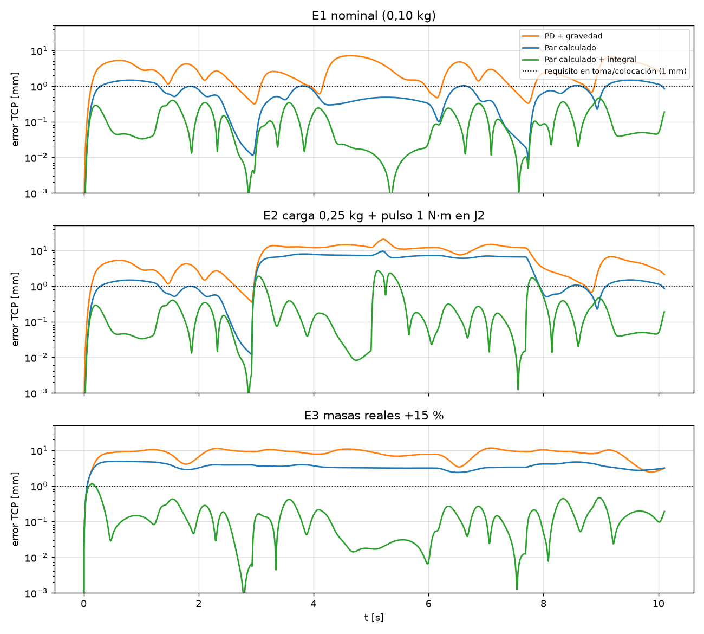
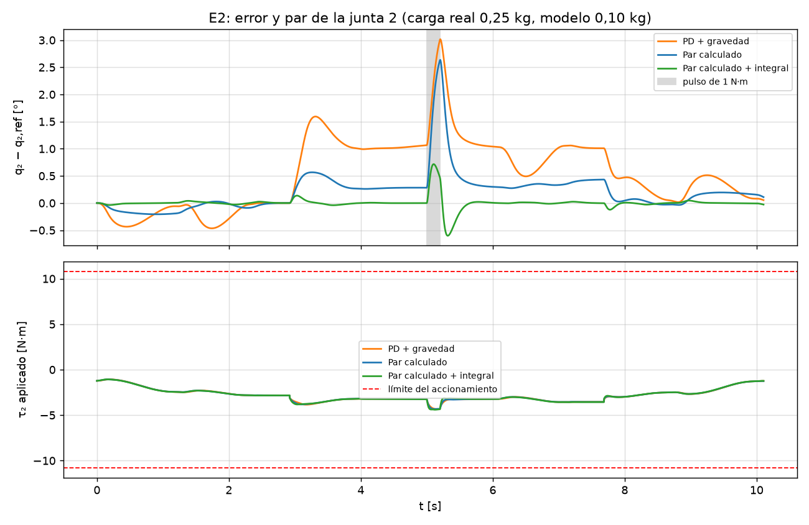

# 7.A Control del brazo (borrador para el informe)

> Código: `brazo/octave/simular_control_brazo.m`, `ensayos_control_brazo.m`, `metricas_control.m`.
> Figuras: `brazo/python/figuras_control.py`. Resultados: `brazo/resultados/ensayos_control.txt` y
> `brazo/resultados/control/E<n>_<control>.csv`.
> Referencias: apunte de cátedra Tema V (§5.3 PD, §5.4 integral y saturación, §5.5–5.7 par calculado,
> §5.8 control muestreado); Barrientos et al. (2007) §§7.1.6 y 7.2.1.

## 7.A.1 Planta, hipótesis y dónde se calcula cada variable

| Elemento | Implementación |
|---|---|
| **Planta** (la integra Octave) | M(q)q̈ + c + g + b q̇ + τ_C tanh(q̇/ε) = τ + d(t), con la dinámica de la sección 5.B (`dinamica_rapida.m`), inercia de rotores reflejada y la pieza real en los tramos con pieza |
| **Integración** | Euler semi-implícito (q̇ ← q̇ + h q̈; q ← q + h q̇), h = 1 ms |
| **Controlador** | Muestreado a T_s = 1 ms con retención de orden cero; usa el **modelo nominal** (pieza de 0,10 kg, masas del CAD, 70 % de la fricción real) |
| **Actuadores** | Fuentes de par ideales con saturación \|τ\| ≤ ηNτ_m,máx = (7,2; 10,8; 5,4; 1,02; 1,02; 0,21) N·m |
| **Mediciones** | q y q̇ exactas: no se modela cuantización de encoder ni ruido |
| **Referencias** | Ciclo de la sección 6.A muestreado a 1 ms: q_d, q̇_d, q̈_d |

**Hipótesis declarada sobre los actuadores.** El controlador manda par. Con motores paso a paso esto exige
drivers de lazo cerrado con control de corriente (tipo FOC). Con drivers de paso abiertos, el brazo se
controlaría en posición y estas leyes describirían el lazo interno del driver. ε = 0,05 rad/s suaviza la
fricción de Coulomb para que la integración sea estable con la inercia mínima de la muñeca.

## 7.A.2 Leyes de control y ajuste de ganancias

Error e = q_d − q (Tema V §5.1). Las tres leyes apuntan a la **misma dinámica del error**:
- ζ = 1;
- ω_n = 20 rad/s en J1–J3 y 40 rad/s en J4–J6. La muñeca necesita más rigidez por su inercia muy baja.

Con T_s = 1 ms, ω_nT_s ≤ 0,04: el muestreo no limita (Tema V §5.8).

1. **Referencia: PD + compensación de gravedad.** τ = K_p e + K_d ė + ĝ(q).
   - Ganancias por junta escaladas por la inercia en HOME:
     - K_p,i = M_ii(q_H)ω_n,i² = (13,3; 24,3; 8,7; 2,06; 1,69; 0,175) N·m/rad;
     - K_d,i = 2ζω_n,iM_ii(q_H) = (1,33; 2,43; 0,87; 0,103; 0,085; 0,0087) N·m·s/rad.
   - El acoplamiento, los términos de velocidad y la variación de M con la postura quedan como perturbación.
2. **Con compensación dinámica: par calculado.** τ = M̂(q)(q̈_d + K_d ė + K_p e) + ĥ(q, q̇) + f̂(q̇).
   - K_p = ω_n², K_d = 2ζω_n.
   - Con modelo exacto el error cumple ë + K_dė + K_pe = 0 en todas las juntas, desacopladas (Tema V §5.7).
3. **Mejora propuesta: par calculado con acción integral.** a_c = q̈_d + K_d ė + K_p e + K_i∫e.
   - Ganancias con triple polo en −ω_n: K_d = 3ω_n, K_p = 3ω_n², K_i = ω_n³.
   - Integración condicionada como antiwindup: no se integra si la junta satura y el error empuja hacia la
     saturación (Tema V §5.4).

## 7.A.3 Ensayos

| Ensayo | Planta real | Modelo del controlador |
|---|---|---|
| E1 nominal | Pieza 0,10 kg | Igual |
| E2 carga + perturbación | Pieza **0,25 kg** (carga máxima) + pulso de **1 N·m en J2** durante 0,2 s a t = 5 s, en pleno traslado | Pieza 0,10 kg |
| E3 incertidumbre de parámetros | Masas e inercias de los eslabones **+15 %** | Valores del CAD |

En todos los casos el modelo conoce solo el 70 % de la fricción.

**Error del TCP** (posición: |p(q) − p(q_d)|; orientación: ángulo de la rotación R_dᵀR, que respeta la
periodicidad). "En la pinza" significa durante el cierre y la apertura, que es el requisito R‑B‑4/5.

Tabla: Resultados de los ensayos de control del brazo

| Ensayo | Control | e_máx [mm] | e_RMS [mm] | e_final [mm] | e en la pinza [mm] | ángulo máx. [°] | ángulo en la pinza [°] | τ₂ pico [N·m] |
|---|---|---|---|---|---|---|---|---|
| E1 | PD+g | 7,14 | 3,31 | 2,10 | 2,42 ✗ | 1,29 | 0,78 | 3,35 |
| E1 | Par calculado | 1,48 | 0,78 | 0,84 | **0,31** ✓ | 0,22 | 0,08 | 3,33 |
| E1 | PC + integral | **0,46** | 0,15 | 0,19 | **0,15** ✓ | 0,06 | 0,03 | 3,33 |
| E2 | PD+g | 20,54 | 8,97 | 2,10 | 14,17 ✗ | 3,10 | 2,84 | 4,33 |
| E2 | Par calculado | 9,52 | 4,83 | 0,84 | 6,76 ✗ | 1,53 | 0,74 | 4,33 |
| E2 | PC + integral | **2,68** | 0,54 | 0,19 | **0,17** ✓ | 0,42 | 0,03 | 4,40 |
| E3 | PD+g | 11,61 | 8,49 | 3,17 | 11,13 ✗ | 2,68 | 2,45 | 3,80 |
| E3 | Par calculado | 4,92 | 3,63 | 3,19 | 3,90 ✗ | 0,83 | 0,58 | 3,78 |
| E3 | PC + integral | **1,13** | 0,22 | 0,19 | **0,19** ✓ | 0,19 | 0,04 | 3,77 |

- **Saturación:** ningún ensayo llega al límite de par. El pico del eje 2 es 4,4 N·m de 10,8 N·m disponibles
  (41 %).
- **Error numérico:**
  - Se repitió E1 con par calculado y h = T_s/4 (primeros 3 s del ciclo).
  - La diferencia en q es 1,0·10⁻⁴ rad, frente a un error de seguimiento de hasta 8·10⁻³ rad.
  - El error de integración es menor que el 2 % del error de control, así que los resultados no dependen del
    paso elegido.

## 7.A.4 Interpretación

- **El par calculado reduce el error a la quinta parte respecto del PD+g** en el caso nominal: 1,5 frente a
  7,1 mm de máximo y 0,31 frente a 2,42 mm en la pinza.
  - El PD+g compensa solo la gravedad. Los pares de inercia y acoplamiento aparecen como error proporcional:
    en el eje 2, unos 0,2 N·m de aceleración sobre K_p = 24 N·m/rad dan alrededor de 8 mrad, unos 2–3 mm en
    el TCP.
  - El residuo del par calculado nominal viene sobre todo de la fricción no modelada (30 %).
- **Con error de modelo, ninguna de las dos leyes cumple R‑B‑4.**
  - En E2, el peso de la pieza que el modelo desconoce, Δm·g·brazo ≈ 0,15·9,81·0,3 ≈ 0,44 N·m en J2, queda como
    error estático Δτ/K_p,eff: unos 6–14 mm en la colocación.
  - En E3 el mecanismo es el mismo: el +15 % de masa no modelada deja un sesgo gravitatorio.
  - Subir ω_n reduciría ese error como 1/ω_n², pero exige más rigidez de los accionamientos y hace al lazo más
    sensible a modos flexibles y retardos no modelados (Tema V §5.3).
- **La acción integral elimina el sesgo** y cumple los requisitos en los tres ensayos:
  - toma y colocación ≤ 0,19 mm y ≤ 0,04°, con R‑B‑4 en 1 mm y R‑B‑5 en 1°;
  - seguimiento ≤ 2,7 mm, con R‑B‑6 en 5 mm.
  - El pulso de 1 N·m se rechaza en unos 0,4 s (figura `control_J2_E2.png`).
  - Como no hay saturación, el antiwindup no llega a actuar en estos ensayos; queda implementado para los
    casos con saturación.
- **Pregunta de investigación (brazo).** *¿Cuánto mejora el seguimiento la compensación dinámica cuando la
  carga real difiere del modelo?*
  - **Alternativas:** PD+g, par calculado y par calculado con integral.
  - **Condiciones fijas:** trayectoria, ω_n, ζ, límites de par y planta.
  - **Variables:** e_máx, e_RMS, e en la pinza, τ pico.
  - **Conclusión:** la compensación dinámica sola mejora unas 5 veces el caso nominal, pero no basta ante una
    carga 2,5 veces mayor que la modelada. La combinación de prealimentación por modelo e integral cumple
    todos los requisitos con el mismo par pico.
  - **Sin verificar:** efectos de cuantización y ruido de encoder, retardo de cómputo, elasticidad de las
    transmisiones impresas y la hipótesis de actuador de par.

**Tipos de error (enunciado §7.3):**
- **Numérico:** < 2 % del total, comprobado con h/4.
- **De modelo:** carga, masas y fricción no modeladas; es el que domina en E2 y E3.
- **De control:** el error transitorio que dejan las ganancias elegidas; es el que domina el PD+g en E1.
