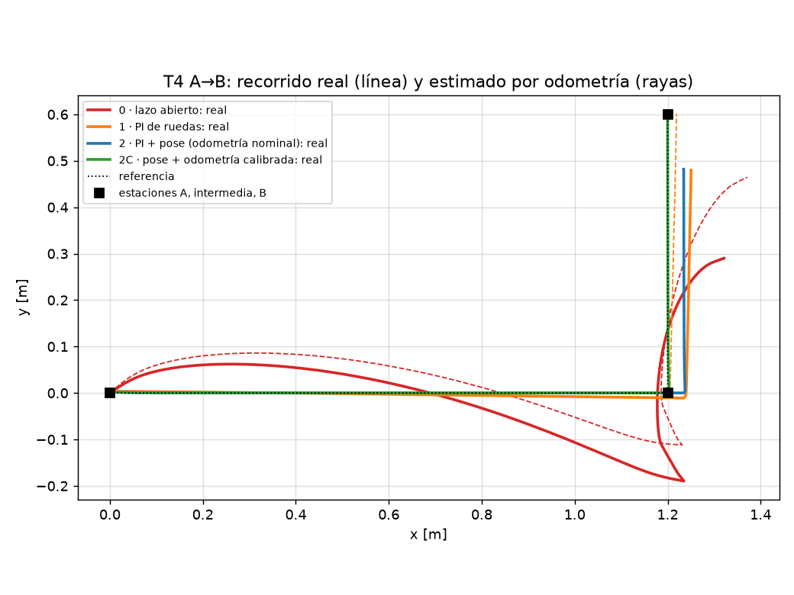
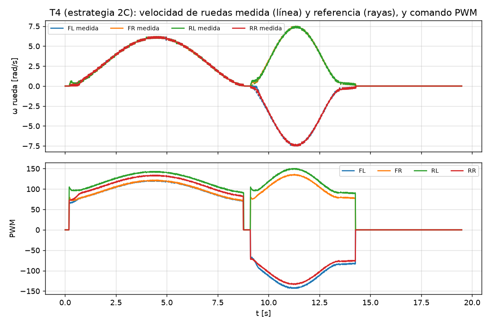
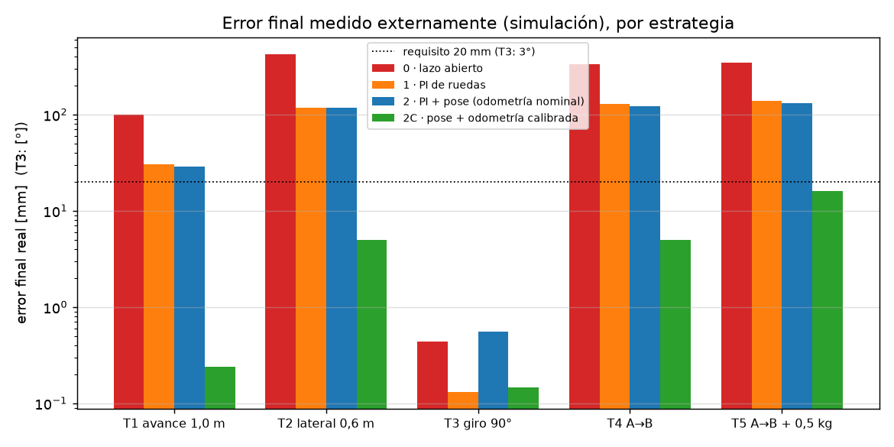

## 7.B Control del AGV

> Firmware: `agv/firmware/agv_osoyoo/`; simulación con el mismo algoritmo: `agv/octave/simular_agv.m`, `ensayos_agv.m`. **Todo lo de esta sección es simulación**; los ensayos físicos están en la sección 8.B.

### 7.B.1 Arquitectura de control del AGV

Tabla: Niveles de control del AGV

| Nivel | Dónde corre | Período | Ley |
|---|---|---|---|
| Velocidad de rueda | Arduino (y su copia en Octave) | 10 ms | u = sgn(ω_r)(\|ω_r\|/K + u_dz) + K_p e + K_i∫e, K_p = 8 PWM/(rad/s), K_i = 80 PWM/rad; integración condicionada; salida nula con referencia y rueda quietas |
| Pose | Arduino | 20 ms | v_b = R(φ)ᵀ(ξ̇_d + K(ξ_d − ξ̂)), K = diag(1,6; 1,6; 2,4) s⁻¹, sobre la odometría |
| Trayectoria | Arduino | 20 ms | Quíntico en (x, y, φ). T se alarga si violaría v_máx = 0,25 m/s, a_máx = 0,3 m/s², ω_máx = 1 rad/s o α_máx = 2 rad/s² |
| Saturación | Arduino | 10 ms | Escala común de las 4 ruedas a ω_rueda,máx = 10 rad/s |

- **Ajuste del PI.** Con la planta G = K/(τs + 1), K = 0,125 rad/s/PWM (medido) y τ ≈ 0,045 s (modelo, con el
  filtro de velocidad), el lazo de rueda queda con ω_n ≈ 15 rad/s y ζ ≈ 1,5: bien amortiguado y lento frente
  a los 100 Hz de muestreo. Las ganancias se diseñaron con K = 0,05; con la K real el lazo es 1,6 veces más
  rápido. **Medido con el robot elevado** (escalón de 3,75 rad/s de rueda,
  `agv/datos_lab/20261111-150746_s1d_pi_ruedas_7V`): sobrepaso de 27–42 % y error en régimen < 2 %. El
  sobrepaso es mayor que el del modelo de 1.er orden: la prealimentación suma la zona muerta de golpe y la
  velocidad medida tiene una resolución de 0,42 rad/s (1 cuenta en 10 ms). La rueda queda dentro de ±10 % a
  los 0,46–0,54 s. Se dejaron las ganancias porque en los GOTO la referencia es suave (quíntica), no un
  escalón.
- **Lazo de pose.** Sus ganancias, de 1,6–2,4 s⁻¹, son unas 4–6 veces más lentas que el lazo de rueda, lo que
  separa las escalas de tiempo.
- **En la planta física**, lo que se realimenta es la velocidad de rueda (encoders) y la pose estimada por
  odometría. La pose real solo se conoce con la medición externa: marcas en el piso y video.

### 7.B.2 Ensayos simulados

Las mismas trayectorias que los ensayos físicos del §5.5, con el modelo ajustado a lo medido en el kit
(sección 5.C.4). El controlador usa **la misma prealimentación que tiene cargada el robot**: K identificado
elevado y zona muerta medida en el piso, distinta para cada rueda. La planta tiene una sola fricción,
igual para las cuatro.

Tabla: Error final real de los ensayos simulados del AGV según la estrategia de control (modelo con parámetros medidos)

| Ensayo | 0 · abierto | 1 · PI de ruedas | 2 · PI + pose | 2C · pose + odometría calibrada | Duración |
|---|---|---|---|---|---|
| T1 avance 1,0 m | 101 mm, 38° | 31 mm | 29 mm | **0,2 mm** | 7,5 s |
| T2 lateral 0,6 m | 426 mm, 48° | 117 mm | 118 mm | **4,9 mm** | 5,3 s |
| T3 giro 90° | 66 mm, 0,4° | 0,1° | 0,6° | **0,2°** | 2,9 s |
| T4 A→B (1,2 m + 0,6 m lateral) | 333 mm, 32° | 130 mm | 123 mm | **4,9 mm** | 14,3 s |
| T5 A→B + 0,5 kg | 344 mm, 32° | 138 mm | 131 mm | **16,0 mm** | 14,3 s |

Error final real respecto de la meta. El PWM máximo es de 157, menor que 255: no hay saturación.

**Calibración.** Los factores se obtienen de T1–T3 corridos con odometría nominal, como real/odometría:
η = (1,029; 0,805; 0,995). Reproducen el deslizamiento del modelo, que a su vez es el medido en el piso, y se
verifican en T4 y T5, que son ensayos distintos.

**Lectura de los resultados:**
- **Lazo abierto.** La prealimentación sola gira el robot 30–50°. Cada rueda tiene su zona muerta en la
  prealimentación (66–104 PWM), pero la fricción real de la planta es la misma para todas: las ruedas con
  u_dz alta reciben de más y las otras de menos, y el recorrido se curva. En el trayecto A→B, además, el tramo
  lateral arranca antes de llegar al punto intermedio (figura del recorrido T4). El abierto no corrige porque
  no mide.
- **PI de ruedas.** Elimina el error de velocidad de cada rueda: el robot hace lo que dicen los encoders.
- **Lazo de pose con odometría nominal.** Sigue casi perfecto a su propia estimación, pero el deslizamiento de
  los rodillos queda invisible: +3 % en avance, **−20 % en lateral** y −0,5 % en giro (valores medidos). Es la
  misma conclusión del §13.4 de Lynch–Park.
- **Odometría calibrada.** En la simulación lleva el error a pocos milímetros y cumple R‑AGV‑3 (≤ 20 mm, ≤ 3°)
  en todos los casos. **En el piso real no alcanza** (sección 8.B): el deslizamiento lateral cambia de una
  maniobra a otra y aparecen el acople lateral → avance y un giro que el modelo no tiene.
- **Con carga.** El deslizamiento lateral extra de la carga (no calibrado) lleva el error a 16 mm: todavía dentro
  del requisito, pero muestra que la calibración depende de la carga.
- **Pregunta de investigación (AGV).**
  - Pregunta: *¿el desplazamiento lateral es menos preciso que el longitudinal y cuánto mejora la
    calibración?*
  - Respuesta en simulación: sí. Con odometría nominal, el lateral de 0,6 m deja 118 mm contra 29 mm en 1,0 m
    de avance. Calibrar reduce ambos más de 20 veces.
  - Respuesta física en la sección 8.B: el lateral es el movimiento menos preciso, pero calibrar solo mejora
    lo que se repite igual en cada maniobra.

**Comunicación.** El enlace con la PC es WiFi (ESP8266 del shield en UDP transparente, firmware agv-0.2.0).
En la red del laboratorio la latencia ida y vuelta fue de 51 ms de mediana (p95 93 ms, máx. 295 ms, 0 perdidos
en 200). El watchdog de comunicación se llevó de 300 a 600 ms. En la hora de más uso aparecieron huecos de
hasta 1,2 s y en las últimas corridas se usaron 1,5 s solo mientras duraba la corrida.

**Pendiente de verificación:** masa, inercias, constante de tiempo de los motores, ruido real del encoder y
variación de V_bat durante el ensayo (la lectura de batería quedó inválida en la segunda mitad de los
ensayos, sección 8.B).
