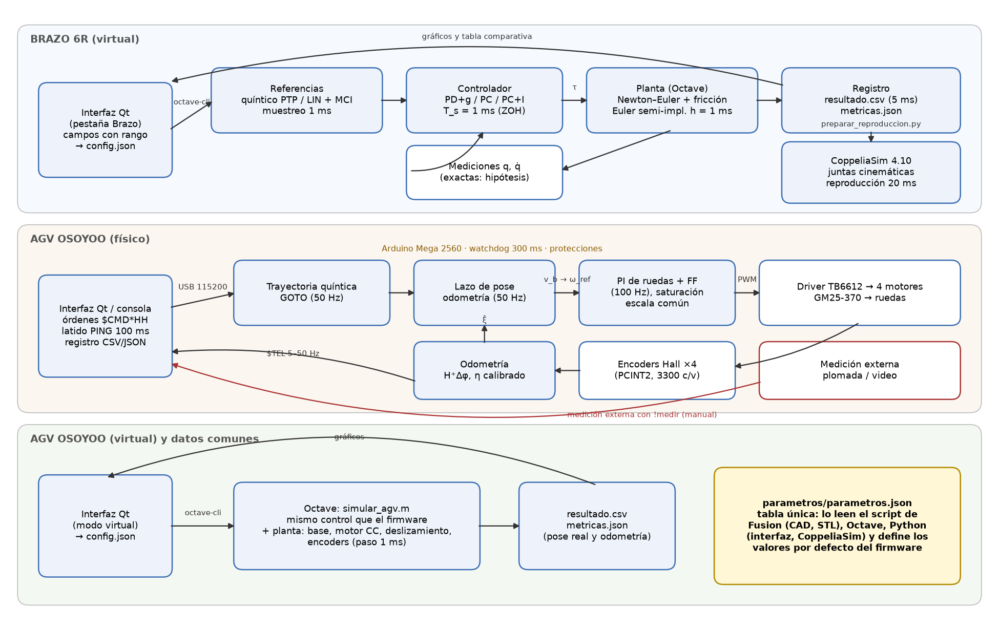

## 7.C Arquitectura de software, tiempos e interfaz

### 7.C.1 Arquitectura

**Quién integra la dinámica y cómo circulan los datos:**
- **Brazo (virtual).** Octave integra la planta y ejecuta el controlador en el mismo bucle
  (`simular_control_brazo.m`).
  1. La interfaz escribe `config.json` con los parámetros del ensayo.
  2. Ejecuta `octave-cli correr_desde_gui(...)`.
  3. Lee `resultado.csv` (t, q_ref, q, q̇, τ, errores del TCP, tramo) y `metricas.json`.
  4. CoppeliaSim **no integra nada**: reproduce el q(t) resultante con juntas en modo cinemático (7.C.4).
- **AGV (físico).** La «planta» es el robot real.
  - La trayectoria, los dos lazos, la odometría y las protecciones corren en la Arduino Mega.
  - La PC envía órdenes de texto con suma de verificación (`$CMD,…*HH`), mantiene vivo el enlace con un
    latido cada 100 ms y registra la telemetría.
  - La pose real solo se conoce con la medición externa (plomada sobre la cuadrícula y video).
- **AGV (virtual).** Octave ejecuta **el mismo algoritmo que el firmware** (`simular_agv.m` es una copia de
  `nucleo.cpp`) sobre la planta simulada. Así, simulación y ensayo físico usan las mismas referencias y
  ganancias.
- **Parámetros.** Todos salen de `parametros/parametros.json`. El firmware tiene los mismos valores por
  defecto, que se pueden cambiar en línea con las órdenes `GAIN`, `LIM`, `MDL`, `CAL` y `GEO`, y se guardan en
  EEPROM.

### 7.C.2 Tiempos

El enunciado (§7.3) pide distinguir cuatro tiempos: el paso de integración numérica, el período del
controlador, la adquisición de datos y la frecuencia de actualización gráfica.

Tabla: Tiempos de integración, control, adquisición y gráficos

| Proceso | Brazo (virtual) | AGV (físico) | AGV (virtual) |
|---|---|---|---|
| Paso de integración de la planta | h = 1 ms, Euler semi-implícito (comprobado con h/4) | — (robot real) | 1 ms |
| Período del controlador | T_s = 1 ms, retención de orden cero | Ruedas 10 ms; pose y trayectoria 20 ms | Igual al firmware |
| Adquisición / registro | CSV cada 5 ms | Telemetría 5–50 Hz (20 por defecto, 50 en identificación) | 10 ms |
| Actualización gráfica | Al terminar la simulación; CoppeliaSim a 20 ms | 10 Hz en la interfaz, 1 Hz en la consola | Al terminar |
| Comunicación y seguridad | — | Latido 100 ms; watchdog 300 ms; órdenes con TTL de 500 ms | — |

**Sincronización y retardos en el AGV.**
- El lazo del firmware es de período fijo: 10 ms medidos con `micros()`.
- La telemetría sale por una **cola no bloqueante**. Si la cola se llena se descarta una línea entera y se
  cuenta, así que la comunicación nunca alarga el período.
- El firmware informa en cada línea de telemetría el tiempo de ejecución del lazo y el peor período
  observado. Así se comprueba durante el ensayo que el control mantiene su período mientras la interfaz
  está funcionando.
- La PC agrega la hora de llegada de cada línea (t_pc). La diferencia con el reloj del Arduino (t_ms) da el
  retardo de comunicación.
- **Medido en el laboratorio** (11/11/2026, 7979 muestras con el robot en movimiento en los ensayos del piso,
  enlace WiFi):
  - ejecución del lazo de 10 ms: mediana 3,4 ms y máximo 5,3 ms, un 53 % del período en el peor caso;
  - peor período: mediana 10,0 ms, p99 11,9 ms y máximo 13,3 ms, por debajo del límite de la protección
    (3 períodos);
  - latencia PC ↔ robot por WiFi (PING → PONG, 200 muestras): mediana 51 ms, p95 93 ms, máximo 295 ms, sin
    pérdidas. En horas de mucho uso de la red hubo huecos de 0,3–1,2 s.
- **Límite encontrado:** con PWM ≥ 200 las interrupciones de los encoders (x4, 4 ruedas) estiran el período a
  18–31 ms. Por eso la velocidad de rueda se limita a 10 rad/s (PWM ~150–190).

### 7.C.3 Interfaz de operación

Una sola aplicación, `interfaz/robot_gui.py` (Python 3.13 con PySide6 y pyqtgraph), con dos pestañas. El
detalle de cada campo está en `interfaz/LEEME_INTERFAZ.md`.

- **Brazo (virtual).**
  - Campos: ley de control, ω_n por grupo de ejes, ζ, fracción de fricción conocida, masa real y supuesta
    de la pieza, escala de masas, perturbación (junta, instante, duración, amplitud) y margen de duración
    de las trayectorias.
  - Cada campo tiene **nombre, unidad y rango**. Los valores se validan en la interfaz y Octave los vuelve a
    acotar.
  - Los cambios rigen en la simulación siguiente.
  - Muestra q_ref y q, el error del TCP y los pares con su límite. Puede superponer hasta cuatro ensayos y
    tiene una tabla comparativa de métricas.
- **AGV, en modo físico o virtual.** Es un selector excluyente: para pasar a virtual hay que desconectar el
  robot.
  - **Conexión:** por WiFi (UDP; el robot avisa su IP y la interfaz recuerda la última conocida) o por USB.
  - Comandos: movimiento manual (`VEL`), ir a pose (`GOTO`, modo 0, 1 o 2), ganancias del PI y del lazo de
    pose, límites, calibración de odometría y frecuencia de telemetría.
  - Cada orden rige en el período siguiente a su confirmación (≤ 10 ms).
  - **Piso de baldosas.** El gráfico principal es el piso del laboratorio en baldosas de 30 cm, con el
    origen A (pose del último `ZERO`) y el punto B.
    - El auto se dibuja con su chasis y sus cuatro ruedas, mirando hacia +y en A, como lo ve el operador
      desde atrás.
    - **Un clic en el piso fija el destino del GOTO** en cualquier punto, con ajuste libre, cada 5 cm, a
      esquinas o a centros de baldosa. Se puede enviar con el clic o con «Ir al destino».
    - La interfaz convierte entre el marco de la pantalla y el del robot (x adelante): x_robot = y_pantalla,
      y_robot = −x_pantalla.
  - **Tiempo real.** El auto se redibuja a 20 Hz con la pose que manda el robot, junto con el trazo de la
    odometría y la referencia. En virtual, la simulación se reproduce animada a velocidad real.
  - Muestra además las velocidades de rueda medidas y de referencia y el PWM.
  - Permite cargar la medición externa y calcula el error con envoltura angular por atan2.
- **Seguridad.**
  - STOP (botón o Esc), DIS (motores libres) y CLR + ARM para salir de una falla.
  - El registro avisa qué falta cuando se intenta mover el robot desarmado o en falla, y marca los rechazos
    del firmware (`NAK`).
  - Casilla para desactivar en RAM la vigilancia de batería si la lectura de A5 no es válida.
  - Al cerrar la ventana se envía DIS. Si la PC deja de comunicarse:
    - con órdenes manuales, el robot para a los 600 ms;
    - en un GOTO entra en **pausa**: congela la trayectoria y frena, y sigue sola cuando vuelven los
      mensajes; recién a los 3 s marca falla (firmware agv‑0.2.2, sección 8.B).
  - El firmware vuelve a acotar todo valor recibido.
- **Registro.** Cada ensayo crea una carpeta con su identificación, fecha, parámetros usados
  (`parametros_usados.json` o `PAR` leídos con `GET`), datos (`resultado.csv` o `telemetria.csv`),
  eventos y notas.
- **Consola de laboratorio** (`agv/pc/agv_consola.py`). Para el trabajo en el laboratorio se agregó una
  consola de texto con guiones (`agv/pc/guiones/`) y medición externa asistida (`!medir`). Registra en el
  mismo formato que la interfaz y funciona por USB o por WiFi (`udp`).
- **Corridas de ensayo** (`agv/pc/corrida.py`). Ejecuta un ensayo completo por WiFi (CLR, ZERO, ARM, GOTO,
  espera del FIN, DIS) y después agrega la medición externa (`--medir`). Las opciones `--amax`, `--wd` y
  `--sin-bat` cambian, solo durante la corrida, la aceleración, el watchdog de comunicación y la vigilancia
  de batería.

### 7.C.4 Entorno gráfico (CoppeliaSim)

Archivos: `coppelia/celda_integrador.ttt`, que se construye con `coppelia/construir_escena.py` y se verifica
con `coppelia/verificar_escena.py` (documentación en `coppelia/LEEME_COPPELIA.md`).

- **Brazo.** STL de Fusion importados en mm, con escala ×0,001, en la pose cero. Seis juntas de revolución
  ubicadas en las tramas DH, con los límites del JSON.
- **Modo de las juntas: cinemático.** No hay motor físico ni controladores internos de CoppeliaSim: todas
  las formas son estáticas y no respondientes.
- **Escena.** Contiene la celda (estaciones A y B, pedestal, mesa y bandeja C), el AGV y la pieza.
- **Reproducción.** Un script Lua de la escena lee `reproduccion.csv`, muestreado a 50 Hz, y en cada paso de
  20 ms fija las juntas, la pose del AGV y la de la pieza. La pieza viaja sobre el AGV, sigue al TCP entre
  el cierre y la apertura de la pinza y queda en C.
- **Origen de los datos.** El CSV combina:
  - la pose del AGV del ensayo simulado T4 (control de pose con odometría calibrada);
  - el q(t) del brazo con par calculado e integral, en el caso nominal.
