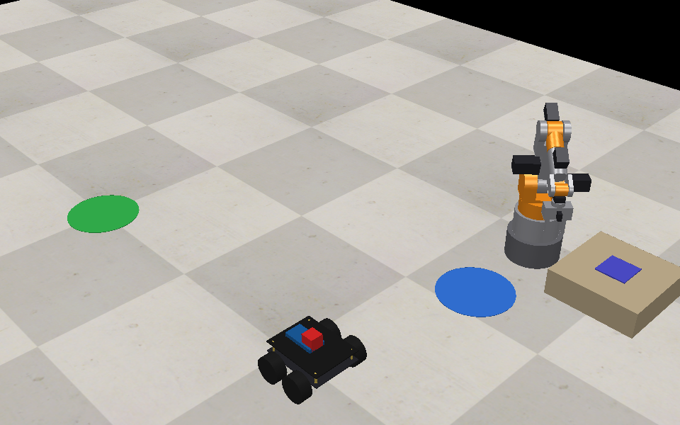
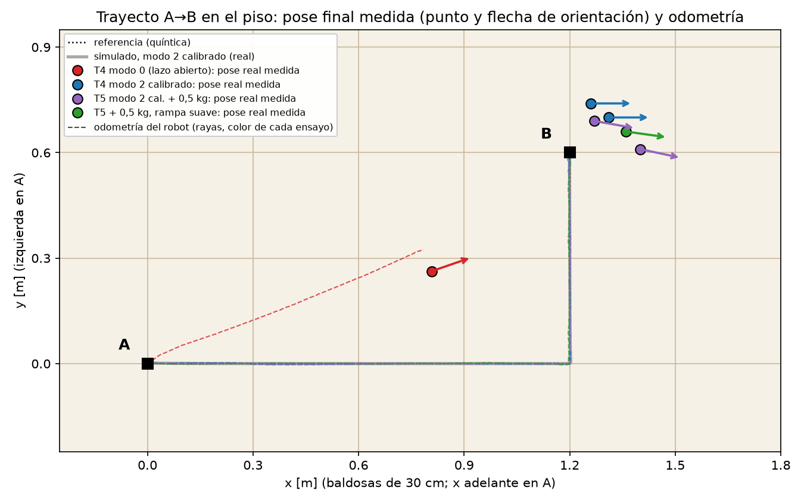
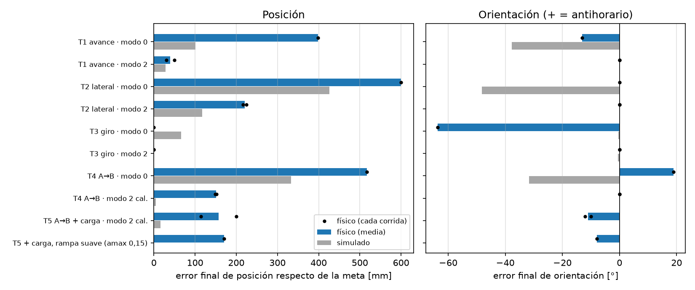
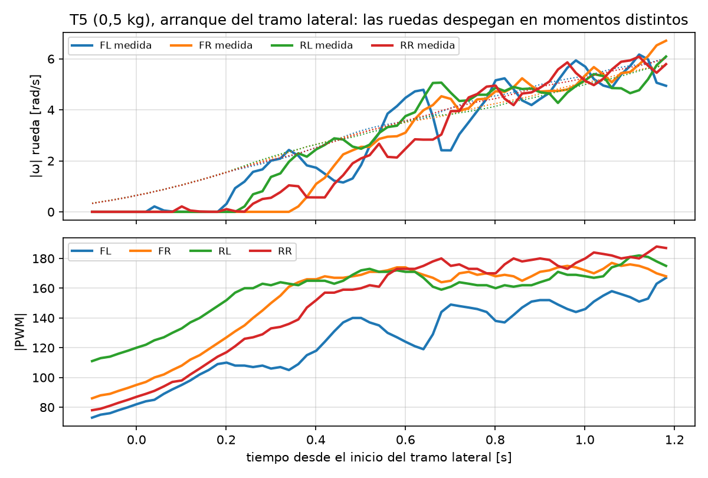

## 8.A Comprobaciones realizadas

Cada modelo y cada herramienta se comprobó contra una referencia independiente. Todas las comprobaciones se
reproducen con los scripts indicados.

Tabla: Comprobaciones del brazo, de la cadena de software y del AGV

| Comprobación | Referencia independiente | Resultado | Script / registro |
|---|---|---|---|
| CAD = modelo | Puntos clave del CAD vs MCD; volúmenes y centros de masa Octave vs Fusion | Error < 10⁻⁹ m; < 0,1 % y < 0,01 mm | `verificar_pose_cero.m`, `verificar_dinamica.m` |
| MCD en poses conocidas | Geometría a mano | < 10⁻¹⁶ m | `verificar_cinematica.m` |
| MCD ∘ MCI | 2000 poses aleatorias | 1,1·10⁻¹³; la configuración original está entre las 8 soluciones en el 100 % | ídem |
| Jacobiano | Derivada numérica de la MCD (200 poses) | 3,2·10⁻¹⁰ | ídem |
| det J en forma cerrada | det numérico (200 poses) | 10⁻¹⁴ | ídem |
| Newton–Euler | Lagrange (50 estados, 0,25 kg) | ΔM 6·10⁻¹⁷; Δτ 10⁻¹⁰ N·m | `verificar_dinamica.m` |
| Dinámica directa | Conservación de la energía en caída libre; balance de trabajo | 8·10⁻⁶ J (h = 2 ms) → 5·10⁻⁷ J (1 ms); 3·10⁻⁷ J | ídem |
| Trayectorias | Límites articulares, derivada numérica, recta cartesiana | Uso máx. 91 % (q̇₁); 8·10⁻⁵ rad/s; 2·10⁻¹⁶ m | `verificar_trayectoria_brazo.m` |
| Error numérico del control | Mismo ensayo con h/4 | 1·10⁻⁴ rad, frente a 8·10⁻³ rad de error de control | `ensayos_control_brazo.m` |
| CoppeliaSim = cálculo | q leídas de la escena vs CSV; TCP vs pieza | 1,2·10⁻¹³ rad; 0,0 mm durante el agarre | `coppelia/verificar_escena.py` |
| Interfaz = scripts | Ensayo desde la interfaz vs script directo | Iguales (AGV T4: 4,9 mm en 13,7 s) | `interfaz/LEEME_INTERFAZ.md` |
| Cinemática mecanum | Rango de H, H⁺H = I, espacio nulo | Rango 3; 2·10⁻¹⁶ | `verificar_cinematica_agv.m` |
| Método de identificación | Parámetros conocidos de la planta simulada; validación con escalones distintos | K y u_dz recuperados; error de validación 0,001 rad/s | `identificacion_simulada.m` |
| Calibración de odometría | η obtenido de T1–T3 vs η de la planta; verificación en T4 y T5 | (1,029; 0,805; 0,995) = valores de la planta | `ensayos_agv.m` |
| Interfaz por WiFi | Robot simulado por UDP en la misma PC | Aviso de IP, GET, PING/PONG y GOTO desde un clic en la cuadrícula correctos | prueba de software |
| Consola de laboratorio | Puerto serie en bucle (sin robot) | Órdenes, fin de movimiento y medición externa correctos | prueba de software |

Figuras de resultados del brazo: sección 6.A (ciclo) y 7.A (control). Del AGV simulado: sección 7.B.

## 8.B Ensayos físicos del OSOYOO

> Ensayos del 07/11 y 11/11/2026 sobre el kit OSOYOO (Arduino Mega 2560, firmware `agv-0.1.2` a `agv-0.2.3`).
> Registros: `agv/datos_lab/<fecha>_<ensayo>_m<modo>_r<rep>/` (telemetría a 50 Hz y eventos). Mediciones
> externas: `agv/datos_lab/mediciones_piso.csv`. Resumen y figuras: `agv/python/figuras_piso.py` →
> `agv/resultados/ensayos_piso_resumen.csv`. Los ensayos usan **las mismas referencias que la simulación**
> (sección 6.B).

**Sesión 1. Puesta en marcha e identificación** (robot elevado).
1. **Cuentas por vuelta:** 1482 (x4), 5 vueltas a mano por rueda, con una dispersión de 1,8 % entre ruedas.
   La ficha del motor (75:1 y 11 PPR) daba 3300: el motor instalado es otra variante (~33,7:1).
2. **Sentidos de motor y de encoder:** comprobados rueda por rueda (máscaras `SIGN 15 5`).
3. **Identificación:** K y zona muerta por rueda (sección 5.C.4).
4. **PI de ruedas:** sobrepaso de 27–42 % y error en régimen < 2 % (sección 7.B.1).
5. **Relevamiento:** 2l_x = 10 cm y 2l_y = 20 cm (±1 cm) con la app de medición del celular. Ni la masa ni el
   patrón de rodillos se midieron; el comportamiento coincide con el patrón X.

**Sesión 2. Ensayos del enunciado (§5.5).**
- **Órdenes por WiFi.** Desde `agv/pc/corrida.py`, sin cable: CLR, ZERO, ARM, GOTO, espera del FIN y DIS.
  El operador queda junto al robot.
- **Referencia externa.** Las baldosas del laboratorio, de 30 × 30 cm. El origen A está en un cruce de juntas
  y el eje x sigue una junta. Al final de cada corrida se fotografía el robot con la app de medición del
  celular: distancia a lo largo de la junta hasta el cruce más cercano, distancia lateral hasta el centro del
  robot y orientación del chasis respecto de las juntas. La orientación sale de un triángulo medido o de la
  foto. Incertidumbre estimada: ±2 cm en posición, ±1° con triángulo y ±3° desde la foto.
- **Diferencias con lo planificado.** Por tiempo, cada ensayo tuvo 1 corrida en modo 0 y 2 en modo 2; el modo
  1 no se ensayó en el piso y T5 en modo 0 tampoco. Se agregaron dos variantes de T5 para estudiar el giro en
  el tramo lateral: rampa suave (amax 0,15 m/s², T5S) y rampa rápida (0,60 m/s², T5A, sin medición).
- **Carga de T5.** Unos 0,5 kg sujetos en el centro de la bandeja; no se pesaron con balanza.
- **Videos** (`videos/`):
  - `agv_interfaz_goto_wifi_mesa_20261111.mp4`: el AGV comandado desde la interfaz por WiFi, con
    destinos elegidos con un clic, sobre la mesa de ensayos del laboratorio. Se ve el auto real y su pose
    en tiempo real en la pantalla.
  - `simulacion_celda_coppelia.mp4`: el ciclo completo en CoppeliaSim (sección 7.C.4), grabado con
    `coppelia/grabar_video.py`.

  Los ensayos T1–T5 en el piso se documentaron con fotos de la medición, no con video.
- **Batería.** Entre 7,0 y 7,4 V. Desde las 17:54 la lectura del divisor de A5 quedó inválida (~2,2 V con
  7,2 V en el tester; probablemente se movió el cable del divisor mientras otro grupo usaba el kit). Las corridas siguientes se hicieron con
  la protección de batería desactivada solo durante la corrida (`--sin-bat`), controlando con el tester.

Tabla: Ensayos físicos planificados

| Ensayo | Propósito | Estado inicial | Referencia | Carga | Parámetros | Repeticiones | Variables registradas |
|---|---|---|---|---|---|---|---|
| T1 | Avance longitudinal y error final | En A, φ = 0, CAL = 1 | (1,0; 0; 0), 7,5 s | Ninguna | GOTO modos 0, 1 y 2 | 2 + 1 + 3 | t, pose odométrica y de referencia, ω_ref y ω_med de las 4 ruedas, PWM, V_bat, pose medida |
| T2 | Lateral y diferencia con T1 | ídem | (0; 0,6; 0), 4,5 s | Ninguna | ídem | 2 + 1 + 3 | ídem |
| T3 | Giro sobre el centro: orientación y desplazamiento del centro | ídem | (0; 0; π/2), 3 s | Ninguna | ídem | 2 + 1 + 3 | ídem |
| — | Calibración de odometría | — | η = real/odometría en T1–T3, modo 2 | — | `calcular_cal.py` → `CAL` | — | η_x, η_y, η_ω con su dispersión |
| T4 | Trayecto entre estaciones A → B | En A | (1,2; 0; 0) → (1,2; 0,6; 0) | Pieza | Modos 0, 1, 2 con CAL = 1; modo 2 con CAL calibrado | 2 + 1 + 3 + 3 | ídem |
| T5 | Repetición con carga conocida | En A | igual que T4 | +0,5 kg pesados, centrados | Modos 0 y 2, CAL calibrado | 1 + 3 | ídem + masa |

### 8.B.1 Resultados

Tabla: Resultados físicos frente a la simulación (error final real respecto de la meta; un valor por corrida válida)

| Ensayo | Modo | n | Error de posición físico | Orientación final física | Deriva de la odometría | Simulado (mismo modo) |
|---|---|---|---|---|---|---|
| T1 avance 1,0 m | 0 | 1 | 399 mm | −13° | 73 mm | 101 mm, −38° |
| T1 | 2 | 2 | 30 / 50 mm | 0° / 0° | 28 / 54 mm | 29 mm, 0° |
| T2 lateral 0,6 m | 0 | 1 | 600 mm: **no se movió** | 0° | 1 mm | 426 mm, −48° |
| T2 | 2 | 2 | 216 / 225 mm (y: 480 mm de 600; x: +180 / +190 mm) | 0° / 0° | 215 / 224 mm | 118 mm, 0° |
| T3 giro 90° | 0 | 1 | centro en A | **26° de 90°** (odometría 14°) | 25 mm | 66 mm, −0,4° |
| T3 | 2 | 2 | centro en A | **90° / 90°** (odometría 90,7° / 90,3°) | 5 / 0 mm | 0,3 mm, −0,6° |
| *Calibración* | — | — | η = real/odometría en modo 2: **η_x = 1,029, η_y = 0,805, η_ω = 0,995** | | | |
| T4 A→B | 0 | 1 | 517 mm (en (808; 263) mm) | +19° | 65 mm | 333 mm, −32° |
| T4 A→B | 2 calibrado | 2 | 149 / 152 mm (en (1310; 700) y (1260; 740) mm) | ≈0° / ≈0° | 151 / 155 mm | 4,9 mm, 0° |
| T5 A→B + 0,5 kg | 2 calibrado | 2 | 114 / 200 mm | −10° / −12° | 117 / 201 mm | 16 mm, 0° |
| T5S (rampa suave) | 2 calibrado | 1 | 171 mm | −8° | 172 mm | — |

- **Duración del trayecto A→B** (desde el arranque hasta el FIN): 14,7 y 15,0 s en T4 calibrado, 17,6 y
  18,3 s en T5 y 16,5 s en T5S. Con carga, los dos tramos terminan por tiempo (T + 2 s) porque las ruedas se
  pegan antes de entrar en la tolerancia de llegada (5 mm, 0,57°).
- **Corridas descartadas** (carpetas `_INVALIDA_`). Las protecciones actuaron como se diseñaron:

  | Corrida | Causa | Protección |
  |---|---|---|
  | T1 m0 r1 | Ruedas pegadas al piso a baja velocidad | Traba (1,5 s); se llevó a 5 s en modo 0 |
  | T2 m0 r1 | Una rueda delantera giraba en el aire | — (repetida) |
  | T3 m2 r1 | Lectura de batería en A5 = 2,2 V | Batería |
  | T4C m2 r2 | Al llegar al punto intermedio seguía corrigiendo 0,6° con las ruedas pegadas | Traba (1,5 s); se llevó a 2,5 s en modo 2, mayor que los 2 s de margen del FIN |
  | T5 m2 r2 | Desnivel en el piso | — (repetida) |
  | T5A m2 r1 | Huecos de WiFi de hasta 1,2 s | Watchdog de comunicación (600 ms) |

**Pausa ante cortes de comunicación** (agv‑0.2.2, después de los ensayos). La corrida T5A se había cortado
por huecos de WiFi de hasta 1,2 s, así que se agregó al firmware una pausa:
- **Funcionamiento:** en un GOTO, si los mensajes se cortan más que el watchdog (600 ms), el robot congela
  la trayectoria y frena, y sigue sola cuando vuelven; recién a los 3 s sin mensajes marca falla.
- **Prueba** (`agv/pc/prueba_pausa_com.py`, robot elevado, por USB y por WiFi): la PC dejó de enviar
  mensajes a propósito.
  - **Corte de 1,5 s en un GOTO de 0,5 m:** la referencia quedó congelada (173–177 mm), las ruedas bajaron
    de 5,9 rad/s a 0 y, al volver los mensajes, el GOTO terminó en 498 mm (3 mm de error por WiFi).
  - **Corte de 4 s:** falla de comunicación a los ~3 s, como se diseñó.

### 8.B.2 Análisis

1. **Lazo abierto contra lazo cerrado.**
   - **En el piso el lazo abierto es mucho peor que en la simulación:** en T2 no llegó a moverse, en T3 giró
     26° de 90° y en T1 y T4 quedó a 40–52 cm.
   - **La causa es la fricción estática.** Por debajo de ~1,5 rad/s las ruedas se pegan al piso, y al
     despegar no lo hacen todas juntas. El modelo tiene solo fricción de Coulomb (igual en reposo y en
     movimiento), así que no lo reproduce.
   - **Los encoders sí miden bien en lazo abierto:** en T4 la odometría quedó a 65 mm de la pose real. Lo que
     falla es que nadie usa esa medición.
   - **El modo 2 corrige lo que miden los encoders:** en avance 1,0 m deja 3–5 cm y el giro de 90° es exacto.
2. **El lateral es el movimiento menos preciso** (pregunta de investigación 3). Para la misma orden, el
   avance tiene 4 cm de error y el lateral 22 cm:
   - los rodillos deslizan, y el robot recorre en y solo el 80 % de lo que miden los encoders;
   - además **avanza 18 cm en x** sin que las ruedas lo registren: un acople lateral → avance que el modelo
     no tiene.
   - El giro sobre el centro es el más preciso: η_ω = 0,995.
3. **La calibración ayuda menos que en la simulación.** Corrige lo que se repite igual en cada maniobra, y
   el lateral no se repite:
   - en el trayecto A→B el tramo lateral deslizó mucho menos que en T2 (real/odometría 0,95–1,0 contra
     0,80), así que η_y = 0,805 lo sobrecorrigió y el robot se pasó 10–14 cm en y;
   - el acople lo corrió 6–11 cm en x;
   - resultado: 15 cm de error en A→B, contra 52 cm del lazo abierto, con muy buena repetibilidad (las dos
     corridas a 6 cm entre sí) y la orientación exacta. **No cumple R‑AGV‑3** (≤ 20 mm, ≤ 3°); la simulación
     calibrada daba 4,9 mm.
4. **Con 0,5 kg el robot termina girado 8–12° en sentido horario**, y la odometría lo ve en menos de 1°.
   - La telemetría del arranque del tramo lateral (figura) muestra el mecanismo: las ruedas despegan con
     160–220 ms de diferencia, y FR, la última, necesita PWM 164 contra 79 sin carga.
   - Mientras una rueda sigue pegada, las otras tres arrastran el chasis y lo hacen girar deslizando. Ese
     giro no pasa por las ruedas, así que **ningún encoder lo puede medir**.
   - Con una rampa más suave (amax 0,15 en vez de 0,30) bajó a −8°, sin desaparecer. Adelantar el despegue
     con una rampa rápida (0,60) no acercó los arranques: siguieron separados por 221 ms.
5. **La simulación sirve para lo que modela.** Con odometría nominal predijo bien el avance (29 mm contra
   30–50 mm) y el error lateral en y (118 mm contra 120 mm), y el giro exacto. No predice la fricción
   estática, el acople lateral → avance, la variación del deslizamiento entre maniobras ni el giro por
   arranques desparejos. Esos cuatro efectos explican la diferencia entre 5 mm simulados y 15 cm reales.
6. **Conclusión de la validación física.** Con odometría de ruedas mecanum, el lazo cerrado lleva el error
   de "metros" a "centímetros" y es repetible. Bajar a milímetros exige medir la pose sin pasar por las
   ruedas: una IMU para el ángulo, marcas en el piso o una cámara (sección 9).

## 8.C Comparación de alternativas (preguntas de investigación)

**1. Brazo: ¿cuánto mejora el seguimiento la compensación dinámica cuando la carga real difiere del modelo?**
- **Alternativas:** PD + gravedad, par calculado y par calculado con integral.
- **Condiciones fijas:** trayectoria, ω_n, ζ, límites de par y planta.
- **Variables:** error del TCP (máximo, RMS y en la pinza), ángulo y τ pico.
- **Resultado** (sección 7.A.3):
  - en el caso nominal, el par calculado reduce el error unas 5 veces frente al PD+g;
  - con 0,25 kg reales y 0,10 kg en el modelo, ni el PD+g (14,2 mm) ni el par calculado (6,8 mm) cumplen
    R‑B‑4 en la colocación;
  - con integral, el error en la colocación es ≤ 0,19 mm en los tres ensayos.
- **Elección:** par calculado con integral.
- **Sin verificar:** cuantización del encoder, retardos, elasticidad de las transmisiones e hipótesis de
  actuador de par.

**2. Brazo: ¿qué reducción conviene en el eje más exigido?**
- **Alternativas:** N₂ = 20 y 30, con el mismo motor.
- **Variables:** carga admisible estática en todo el espacio articular, uso del motor, velocidad del motor
  e inercia reflejada.
- **Resultado** (5.B.4 y 6.A.3):
  - con 20, la carga admisible es 0,221 kg y no alcanza los 0,25 kg de R‑B‑3;
  - con 30 es 0,379 kg y el límite pasa al eje 4;
  - el costo es una velocidad de motor 1,5 veces mayor (450 rpm a 90 °/s) y una inercia reflejada 2,25
    veces mayor.
  - en el ciclo, el motor 2 trabaja al 31 % de pico.
- **Elección:** N₂ = 30.

**3. AGV: ¿el desplazamiento lateral es menos preciso que el longitudinal, y cuánto mejora la calibración de
la odometría?**
- **Alternativas:** avance de 1,0 m vs lateral de 0,6 m; odometría nominal vs calibrada.
- **Variables:** error final real, deriva de la odometría y repetibilidad.
- **Resultado en simulación** (7.B.2, modelo con los parámetros medidos):
  - con odometría nominal, el lateral deja 118 mm en 0,6 m, frente a 29 mm en 1,0 m de avance;
  - calibrar reduce ambos más de 20 veces.
- **Resultado físico** (8.B):
  - el lateral es claramente el menos preciso: 22 cm en 0,6 m contra 4 cm en 1,0 m, por deslizamiento en y
    (−20 %) y acople a x (+18 cm);
  - la calibración no se transfiere bien de T2 al trayecto A→B porque el deslizamiento lateral cambia con la
    maniobra (0,80 en T2 y 0,95–1,0 en A→B). Error A→B: 15 cm calibrado contra 52 cm en lazo abierto.
- **Respuesta:** sí, el lateral es menos preciso. Con un factor fijo por eje, la calibración corrige el
  promedio de una maniobra pero no la variación entre maniobras.

**4. AGV: ¿cuánto aporta cada nivel de control?**
- **Alternativas:** lazo abierto (solo prealimentación con el modelo identificado), PI de ruedas y PI más lazo
  de pose.
- **Resultado en simulación (T4):** 333, 130 y 123 mm. El abierto falla porque la prealimentación de cada
  rueda no coincide con la fricción real y porque los motores no son iguales.
- **Resultado físico:**
  - modo 0: 517 mm y 19° en T4; en T2 no se movió y en T3 giró 26° de 90°;
  - modo 2 calibrado: 15 cm y 0°;
  - el modo 1 no se ensayó en el piso.
  - En lazo abierto la fricción estática (ruedas que se pegan por debajo de ~1,5 rad/s) es mucho peor que en
    el modelo.
- **Respuesta:** el lazo de velocidad de rueda con encoders aporta casi toda la mejora: convierte un robot que
  no completa las maniobras en uno que llega a centímetros con la orientación correcta. El lazo de pose
  agrega la llegada exacta según la odometría. El error que queda es el de la odometría misma.

**5. Diseño: ¿cómo conviene imprimir la pieza crítica?**
- **Alternativas:** L2 acostado (capas normales al eje de la articulación) o parado (capas normales al
  eslabón).
- **Resultado** (4.B): acostado da un FS entre 26 y 29 % mayor, deja los agujeros verticales y, dividido en
  dos, entra en la cama.
- **Elección:** acostado, en dos mitades con pasadores.
